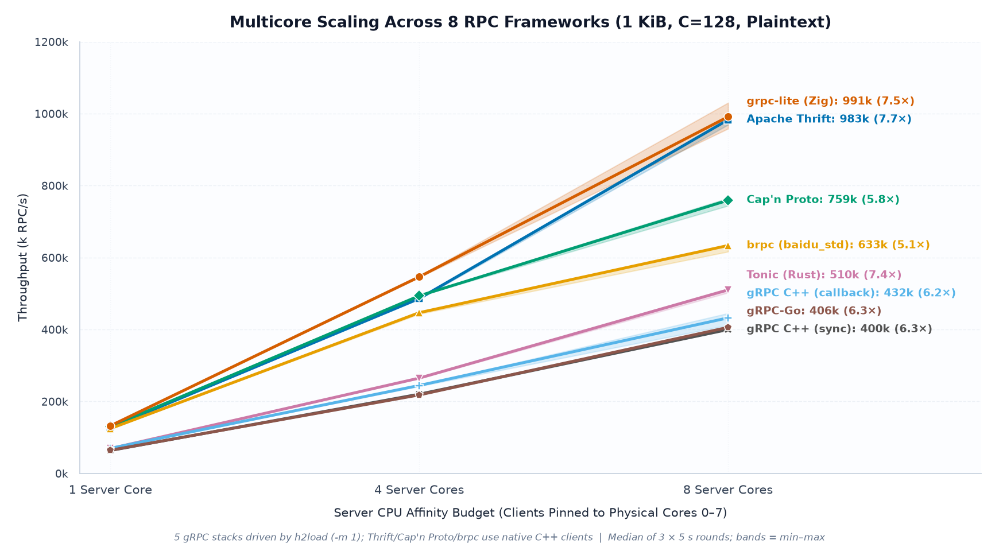

# Cross-Framework RPC Benchmark

A reproducible Linux benchmarking suite comparing **8 RPC server stacks** across wire protocols, concurrency levels, payload sizes, multicore CPU budgets, streaming cardinalities, and certificate-verified TLS:

- **gRPC stacks:** `grpc-lite` (Zig), `Tonic` (Rust), `gRPC-Go`, `gRPC C++` (sync & callback/reactor APIs)
- **Native binary RPC stacks:** `Apache Thrift`, `Cap'n Proto`, `brpc` (`baidu_std`)

> **Looking for the performance results and Benchkit charts?**  
> Read the full human-readable post-fix report in **[`report/README.md`](report/README.md)** (780 formal runs, 524.3M RPCs, 0 errors, 10 Benchkit PNG/PDF charts, powered by neutral third-party `h2load` across all gRPC Unary matrices).

---

## Latest Post-Fix Highlights (`2026-11-25`, `grpc-lite 0f6c850`, `h2load` Client)

| Benchmark Matrix | Scope | Headline Result (Median of 3 × 5 s Rounds) |
| --- | --- | --- |
| **Native + `h2load (-m 1)` Cross-Protocol** | 8 frameworks, 1-conn/worker closed-loop Plaintext, 360 runs | **Thrift (`15.6 µs`) & grpc-lite (`16.0 µs`)** virtually tie on 1 KiB P50 latency; **grpc-lite takes #1 on 8-core Plaintext (`1,069k RPC/s`, `8.13×`, `159 µs` P99)** ahead of Thrift (`984k`), Cap'n Proto (`772k`), and brpc (`637k`); **Thrift** leads 64 KiB (`5,214 MiB/s`) & 1 MiB (`4,441 MiB/s`). |
| **Multiplexed gRPC (`h2load` PT & TLS)** | 5 gRPC servers, `h2load` (`nghttp2/1.69.0`), 1/2/4/8 cores + 64 KiB / 1 MiB / asymmetric, 240 runs | All 5 servers reach **92%–100% server CPU**: **grpc-lite** (`0f6c850`, OpenSSL 4.0.3) scales **3.93× on 4 cores (`1.80M` PT / `1.53M` TLS)** and reaches **`2.48M` PT / `2.18M` TLS on 8 cores** (**4.1× / 3.9×** Tonic at `604k / 552k`) with **1.35–2.86 ms** P99; **C++ callback** leads 64 KiB / 1 MiB bulk bandwidth; **Tonic** leads `64 KiB → 64 B` (`57.2k / 38.6k`). |
| **gRPC Streaming Matrix** | 5 gRPC servers, Go (`1.83.2`) & Tonic (`0.14.6`) clients, PT & TLS, 180 runs | **Tonic** leads server-streaming across all 4 cells (**44.7k / 53.1k** PT, **39.1k / 43.9k** TLS); **grpc-lite** leads Go-client client-stream (**68.4k / 47.7k**) and Tonic-client bidi (**8.80k / 6.98k**). |




See **[`report/README.md`](report/README.md)** for all 10 Benchkit figures (latency, concurrency, P99 tail latency, 8-framework multicore, large & asymmetric payloads, multiplexed `h2load` Plaintext/TLS scaling, and streaming), complete tables, and methodology limits.

---

## Repository Layout

```text
rpc-framework-bench/
├── proto/                          # Shared gRPC wire schema (grpc.testing.TestService)
├── workloads/                      # Benchmark servers, clients, and native protocol adapters
│   ├── go/                         # gRPC-Go load generator (client/) and server (server/)
│   ├── rust-tonic/                 # Rust Tonic server and load generator (Cargo project)
│   ├── cpp-grpc/                   # gRPC C++ server supporting sync & callback APIs
│   └── native-cpp/                 # Closed-loop C++ adapters (brpc, Thrift, Cap'n Proto, gRPC)
├── harness/                        # Build, execution, validation, and Benchkit reporting scripts
│   ├── build.sh                    # Builds Go, Rust Tonic, and C++ gRPC binaries into bin/
│   ├── run.sh                      # Controlled single-matrix runner with CPU pinning & telemetry
│   ├── sweep.sh                    # Concurrency saturation sweep driver
│   ├── campaign_native.py          # Benchkit 8-framework Plaintext driver (native C++ + h2load -m 1)
│   ├── campaign_extended.py        # Extended / streaming-only gRPC driver (Go & Tonic clients)
│   ├── campaign_h2load.py          # 240-run neutral h2load (nghttp2) multiplexed gRPC Unary driver
│   ├── plot_report.py              # Generates PNG/PDF report figures via Benchkit lwchart
│   ├── certificates.sh             # Generates local CA and localhost SAN TLS certificates
│   ├── summarize/                  # Go JSONL summarizer (summarize.go) + unit tests
│   └── tests/                      # Parameter validation & TLS trust/hostname rejection tests
├── report/                         # Human-readable performance report and Benchkit figures
│   ├── README.md                   # Curated post-fix report with tables, insights, and caveats
│   └── figures/                    # 10 publication-grade PNG + PDF Benchkit charts
└── results/                        # Raw benchmark datasets
    ├── README.md                   # Dataset index
    └── 2026-11-25-h2load-0f6c850/  # Latest 780-run formal dataset (h2load Unary + Streaming)
```

---

## Quick Start

### Requirements

- Linux with `/proc`, `taskset`, `getconf`, GNU `date`, `jq`, `openssl`, `curl` (HTTP/2), and `h2load` (`nghttp2`)
- Go 1.26+, Rust/Cargo (matching `workloads/rust-tonic/Cargo.lock`), C++17 compiler, CMake, Ninja
- gRPC C++ & Protobuf CMake packages (and for `workloads/native-cpp/`: brpc, Thrift, Cap'n Proto — see [`workloads/native-cpp/README.md`](workloads/native-cpp/README.md))
- External `grpc-lite` interop server binary (`GRPC_LITE_SERVER`)
- Python 3.12+ with `benchkit`, `pandas`, `matplotlib`, and `seaborn` for Benchkit campaigns and report plotting

### 1. Build & Validate

```sh
CMAKE_PREFIX_PATH=/path/to/grpc-install ./harness/build.sh
bash harness/certificates.sh

# Run unit and harness validation tests
go test -race ./...
cargo test --locked --manifest-path workloads/rust-tonic/Cargo.toml
c++ -std=c++17 -pthread workloads/native-cpp/load_test.cc -o /tmp/rpc-load-test && /tmp/rpc-load-test
bash harness/tests/run-validation-test.sh
python3 harness/tests/tls-validation-test.py
```

### 2. Run Benchmark Campaigns

All formal campaigns require CPUs `0–15` to be distinct physical cores (`campaign_native.py` & `campaign_extended.py` pin clients to `0–7` and servers to `15`, `12–15`, or `8–15`; `campaign_h2load.py` allocates `0–11` to clients for `1 / 2 / 4` server cores and `0–7` for `8` server cores). Output directories must not already exist.

```sh
export GRPC_LITE_SERVER=/absolute/path/to/grpc-lite-interop-server
export GRPC_LITE_VERSION=grpc-lite/0f6c850-openssl
export GRPC_CPP_VERSION=grpc-cpp/1.84.3

# Benchkit 8-framework native plaintext campaign (120 configs × 3 rounds)
MPLBACKEND=Agg /path/to/benchkit-venv/bin/python harness/campaign_native.py \
  --output results/sweeps/native-run

# Neutral multiplexed gRPC Unary via h2load (1/2/4/8 cores + 64 KiB / 1 MiB / asymmetric; 240 formal runs)
python3 harness/campaign_h2load.py --output results/sweeps/h2load-run

# Streaming-only gRPC campaign (Go & Tonic clients, PT & TLS; 180 formal runs)
python3 harness/campaign_extended.py --streaming-only --output results/sweeps/streaming-run

# Single controlled run or concurrency sweep
CLIENT_IMPL=tonic ./harness/run.sh
RUN_ID=my-sweep bash ./harness/sweep.sh
go run ./harness/summarize/summarize.go results/sweeps/my-sweep/*.jsonl
```

Add `--smoke` to `campaign_native.py`, `campaign_h2load.py`, or `campaign_extended.py` for a fast end-to-end validation pass before formal measurement.

### 3. Regenerate Benchkit Report Charts

```sh
/path/to/benchkit-venv/bin/python harness/plot_report.py \
  --dataset results/2026-11-25-h2load-0f6c850 \
  --output report/figures
```

---

## Methodology Principles

- **Neutral third-party gRPC Unary load generation (`h2load`):** All gRPC Unary matrices use off-the-shelf `h2load` (`nghttp2`) so fast servers are never capped by Go, Tonic, or blocking C++ client CPU ceilings (and without using any benchmarked server's own client). Every `h2load` run is preceded by a strict `curl` HTTP/2 pre-flight verifying `HTTP/2 200`, trailer `grpc-status: 0`, and exact Protobuf response length.
- **Synchronized warmup & unbiased throughput:** All built-in load generators (`go/client`, `rust-tonic`, `native-cpp/load.h`) connect eagerly, synchronize workers on a post-warmup monotonic barrier, and compute unbiased per-worker active-time throughput `sum(completed_i / active_seconds_i)`.
- **Zero-allocation O(1) latency histograms:** Clients record latencies in a fixed-memory log-linear histogram (8-bit mantissa, `<0.4%` error, exact below 512 ns) rather than growing and sorting multi-million-element arrays after measurement.
- **Fair thread budgets & payload handling:** All servers align concurrency/polling budgets with `SERVER_THREADS` / CPU affinity and avoid artificial per-RPC channel ping-pong or avoidable heap churn.
- **Zero-error gating & transparent variance:** Every client validates response lengths, streaming message counts, aggregate bytes, and terminal `OK` status; any error fails the run. Reports present round medians with observed min–max bounds.

## References

- [Official gRPC Benchmarking Guide](https://grpc.io/docs/guides/benchmarking/)
- [Benchkit Benchmarking Framework](https://github.com/open-s4c/benchkit)
- [gRPC-Go Benchmark Sources](https://github.com/grpc/grpc-go/tree/master/benchmark)
- [Tonic 0.14.6 Documentation](https://docs.rs/tonic/0.14.6/tonic/)
