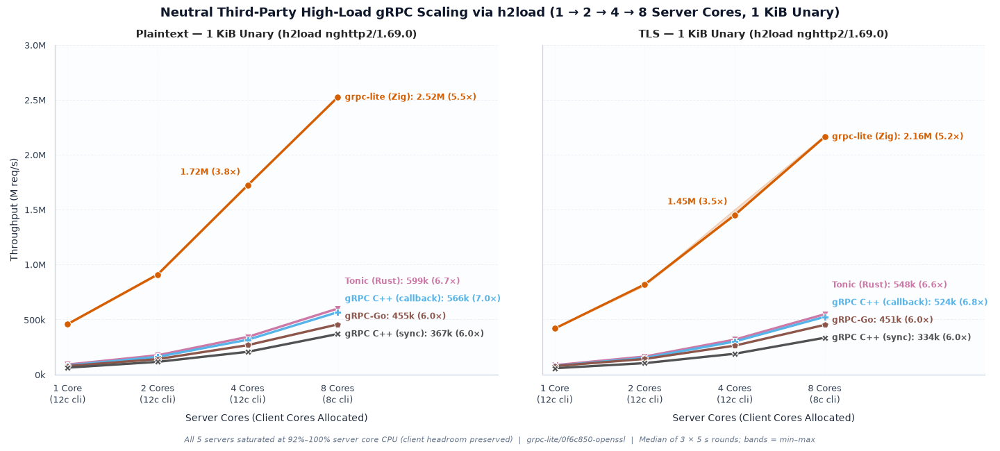
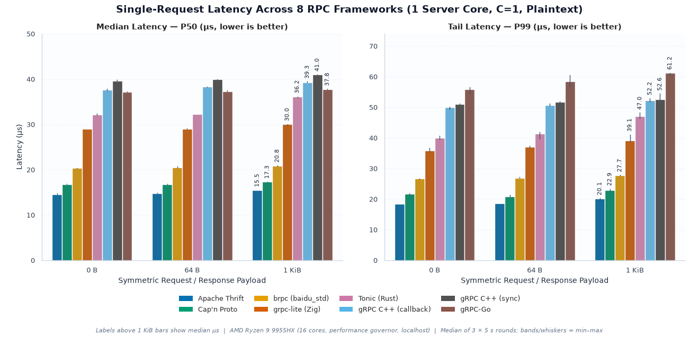

# Cross-Framework RPC Benchmark

A reproducible, zero-error Linux benchmarking suite evaluating **8 production RPC server stacks** across wire protocols, latency, concurrency, multicore scaling, large & asymmetric payloads, certificate-verified TLS, and gRPC streaming.

<p align="center">
  <strong>8 RPC Stacks</strong> &nbsp;·&nbsp;
  <strong>780 Formal Runs</strong> (+260 Smoke) &nbsp;·&nbsp;
  <strong>524.3M Verified RPCs</strong> &nbsp;·&nbsp;
  <strong>0 Errors</strong> &nbsp;·&nbsp;
  <strong>10 Benchkit Charts (PNG + PDF)</strong>
</p>

<p align="center">
  <a href="#executive-scorecard">Scorecard</a> &nbsp;·&nbsp;
  <a href="#key-visualizations">Visualizations</a> &nbsp;·&nbsp;
  <a href="#benchmarked-stacks-and-environment">Stacks &amp; Hardware</a> &nbsp;·&nbsp;
  <a href="#experimental-design-and-fairness">Methodology</a> &nbsp;·&nbsp;
  <a href="#reproducing-the-benchmark">Reproduce</a> &nbsp;·&nbsp;
  <a href="#threats-to-validity">Caveats</a> &nbsp;·&nbsp;
  <a href="report/README.md"><strong>Full Report →</strong></a>
</p>

> [!TIP]
> **Want all 10 Benchkit figures, full data tables, and workload-specific selection advice?**  
> Read the complete curated performance report in **[`report/README.md`](report/README.md)**. Raw machine-readable CSV/JSONL outputs and SHA-256 binary provenance live under [`results/2026-11-25-h2load-0f6c850/`](results/2026-11-25-h2load-0f6c850/README.md).

---

## Executive Scorecard

All values below are **medians of 3 × 5 s formal runs** on an **AMD Ryzen 9 9955HX** (16 physical cores, `performance` governor, localhost TCP) with **0 errors**. All gRPC Unary benchmarks use neutral, off-the-shelf **`h2load` (`nghttp2/1.69.0`)** so fast servers are never capped by client CPU bottlenecks or self-benchmarked with their own clients.

| RPC Stack | Protocol | 1 KiB Latency P50 / P99 (`C=1`, 1c) | 8-Core Plaintext `-m 1` (`C=128`, P99) | 1 MiB Plaintext (`C=32`, 1c) | Multiplexed `h2load` 8c PT / TLS (`1 KiB`) | Server-Stream 1c PT / TLS (`16×1 KiB`, Tonic cli) |
| --- | --- | ---: | ---: | ---: | ---: | ---: |
| **grpc-lite** (`0f6c850`, Zig) | gRPC / HTTP/2 | 16.0 / 22.0 µs | **1,069k** (**159 µs**) | 2,613 MiB/s | **2.48M / 2.18M** | 48.0k / 34.5k |
| **Apache Thrift** (`0.25.0`) | Binary / Framed | **15.6 / 21.3 µs** | 984k (226 µs) | **4,441 MiB/s** | — | — |
| **Cap'n Proto** (`1.5.0`) | Two-party RPC | 17.6 / 23.5 µs | 772k (637 µs) | 3,530 MiB/s | — | — |
| **brpc** (`1.18.0`) | `baidu_std` | 20.9 / 28.9 µs | 637k (248 µs) | 3,744 MiB/s | — | — |
| **Tonic** (`0.14.6`, Rust) | gRPC / HTTP/2 | 22.0 / 29.0 µs | 511k (466 µs) | 2,844 MiB/s | 604k / 552k | **53.1k / 43.9k** |
| **gRPC C++ callback** (`1.84.3`) | gRPC / HTTP/2 | 24.0 / 36.0 µs | 447k (1,240 µs) | 3,209 MiB/s | 571k / 531k | 8.5k / 7.5k |
| **gRPC-Go** (`1.83.2`) | gRPC / HTTP/2 | 22.0 / 44.0 µs | 405k (1,280 µs) | 3,314 MiB/s | 450k / 452k | 36.9k / 29.7k |
| **gRPC C++ sync** (`1.84.3`) | gRPC / HTTP/2 | 27.0 / 35.0 µs | 397k (751 µs) | 3,072 MiB/s | 370k / 337k | 8.6k / 7.8k |

*Note: Compare stacks **within each column/matrix** only — Part 1 uses strict 1-connection-per-worker (`-m 1`), Part 2 uses multiplexed HTTP/2 (`-m 16`), and Part 3 uses Go/Tonic streaming clients. Non-HTTP/2 stacks (`—`) are evaluated in Part 1 only.*

### Key Takeaways

- **HTTP/2 + gRPC can match raw binary protocols on latency & 8-core throughput:** Freed from blocking C++ gRPC client overhead (`~14 µs`), **`grpc-lite` hits `16.0 µs` P50** (virtually tied with Apache Thrift at `15.6 µs`) and scales **`8.13×` to `1.07M RPC/s`** (`159 µs` P99) on 8 cores even with multiplexing disabled (`-m 1`).
- **True gRPC multicore ceilings under neutral `h2load`:** All 5 gRPC servers reach **92%–100% server core saturation** across 1 → 2 → 4 → 8 cores. **`grpc-lite` (OpenSSL 4.0.3)** scales **`3.93×` on 4 cores (`1.80M` PT / `1.53M` TLS)** and hits **`2.48M` PT / `2.18M` TLS on 8 cores** (**4.1× / 3.9×** Tonic) with **`1.35–2.86 ms` P99** under 1,536 in-flight streams.
- **No single winner across every workload:**
  - **Bulk plaintext & non-gRPC binary:** **Apache Thrift** leads 64 KiB (`5,214 MiB/s`) and 1 MiB (`4,441 MiB/s`, `15.4 ms` P99).
  - **Multiplexed gRPC large payloads (64 KiB / 1 MiB):** **gRPC C++ (callback)** leads bandwidth (`3,431 / 2,329 MiB/s` @ 64 KiB; `3,595 / 2,262 MiB/s` @ 1 MiB), while **`grpc-lite`** delivers **4×–7× tighter P99** (`9–14 ms` @ 64 KiB; `34–51 ms` @ 1 MiB).
  - **Server-streaming & large uploads:** **Tonic (Rust)** leads server-streaming across all 4 client/transport cells (`53.1k` PT / `43.9k` TLS) and dominates `64 KiB → 64 B` uploads (`57.2k` PT / `38.6k` TLS).
  - **Zero TLS penalty in Go:** **gRPC-Go (`1.83.2`)** maintains ~100% TLS parity on 1–8 cores (`450k` PT vs `452k` TLS @ 8c) and leads Go-client bidi ping-pong (`5.83k / 5.40k`).

---

## Key Visualizations

All figures are generated deterministically via [Benchkit](https://github.com/open-s4c/benchkit) (`benchkit.lwchart`) with colorblind-safe palettes and exact observed min–max variance bands/whiskers.

### 1. Neutral High-Load gRPC Multicore Scaling (`h2load`, Plaintext & TLS)


### 2. Cross-Protocol 8-Core Scaling Across All 8 Frameworks (`-m 1`, Plaintext)


### 3. Single-Request Latency Across All 8 Frameworks (`0 B / 64 B / 1 KiB`, `C = 1`)


> See **[`report/README.md`](report/README.md)** for all 10 Benchkit figures, including concurrency saturation & log-scale P99, symmetric 64 KiB / 1 MiB bandwidth (PT & TLS), asymmetric `64 B ↔ 64 KiB` directionality, and client/server/bidi streaming.

---

## Benchmarked Stacks and Environment

### Software Matrix

| Stack | Role | Version / Commit | Wire / TLS Stack | Concurrency Model |
| --- | --- | --- | --- | --- |
| **`h2load`** | Neutral gRPC Unary client | `nghttp2/1.69.0` | HTTP/2 (`h2c` / `h2`), OpenSSL 4.0.3 | Multi-threaded `libev` event loops |
| **grpc-lite** | gRPC server | `0f6c850` (Zig `0.17.0`) | HTTP/2 + OpenSSL 4.0.3 | Per-core `io_uring` reactors (`ReleaseFast`) |
| **Tonic** | gRPC server & streaming client | `0.14.6` (Rust `1.100.0`) | HTTP/2 (`hyper`/`h2`) + `ring` | Tokio `1.53.1` multi-thread runtime (`--locked`) |
| **gRPC C++** | gRPC server (`callback` & `sync`) | `1.84.3` (GCC `16.2.1`) | HTTP/2 + BoringSSL/OpenSSL | `SERVER_THREADS`-tuned CQs / `ResourceQuota` |
| **gRPC-Go** | gRPC server & streaming client | `1.83.2` (Go `1.26.2`) | HTTP/2 + Go `crypto/tls` | Goroutines with matched `GOMAXPROCS` |
| **Apache Thrift** | Native server & client | `0.25.0` (GCC `16.2.1`) | Framed binary TCP | Nonblocking I/O worker threads |
| **Cap'n Proto** | Native server & client | `1.5.0` (GCC `16.2.1`) | Two-party RPC over TCP | Pre-bound `SO_REUSEPORT` loops (`TCP_NODELAY`) |
| **brpc** | Native server & client | `1.18.0` (GCC `16.2.1`) | `baidu_std` over TCP | `bthread` M:N work-stealing scheduler |

### Testbed Hardware

| Parameter | Specification |
| --- | --- |
| **CPU** | AMD Ryzen 9 9955HX — 16 physical cores / 32 threads (`x86_64`, 1 socket, 1 NUMA node) |
| **Caches** | 768 KiB L1d · 512 KiB L1i · 16 MiB L2 · 64 MiB L3 (2 × 32 MiB CCDs) |
| **OS & Frequency** | Fedora Linux 45, `performance` scaling governor verified on CPUs `0–15` |
| **Transport** | Localhost IPv4 TCP (`127.0.0.1`), no compression, no retries, no request logging |
| **TLS Setup** | Local CA (`bin/certs/ca.pem`) + `localhost` SAN certificate; stack-default TLS 1.3/1.2 & ciphers |

---

## Experimental Design and Fairness

Benchmark suites are easy to distort unintentionally. This suite enforces six structural safeguards verified by automated unit and harness tests:

1. **Neutral Third-Party Load Generator (`h2load`):** No gRPC server is benchmarked with its own client. Using off-the-shelf `h2load` (`nghttp2/1.69.0`) eliminates the ~`14 µs` client RTT penalty of blocking C++ gRPC and the 8-core client CPU ceiling (`780%/800%`) of Go/Tonic load generators, saturating all 5 gRPC servers to **92%–100% server core CPU**.
2. **Strict Topology Parity Across Protocols:** In the 8-framework comparison (Part 1), `h2load` is locked to **`-m 1`** (1 in-flight RPC per TCP connection) so connection count and concurrency (`C = 1, 8, 32, 128`) match the native C++ Thrift, Cap'n Proto, and brpc clients apples-to-apples. HTTP/2 multiplexing (`-m 16`) is evaluated separately in Part 2.
3. **Physical Core Isolation & Asymmetric Headroom:** Every campaign asserts via `/sys/devices/system/cpu/*/topology/` that CPUs `0–15` are 16 distinct physical cores (no SMT sibling sharing). Part 1 & 3 pin clients to `0–7` and servers to `15` / `12–15` / `8–15`; Part 2 allocates **12 client cores (`0–11`)** for `1 / 2 / 4` server cores and `8` client cores (`0–7`) for `8` server cores. Server execution order rotates across rounds.
4. **Zero-Error Wire-Level Validation:** Before every `h2load` run, a pre-flight `curl` HTTP/2 call verifies `HTTP/2 200`, trailer `grpc-status: 0`, and exact Protobuf response byte length (with CA verification on `localhost` for TLS); every `h2load` run enforces `0 failed / 0 errored / 0 timeout` and full aggregate byte counts. Built-in native and streaming clients validate every response length, message count, aggregate byte count, and terminal `OK` status.
5. **Unbiased Timing & Zero-Allocation Histograms:** All built-in clients (`go/client`, `rust-tonic`, `native-cpp/load.h`) connect eagerly, synchronize workers on a post-warmup monotonic barrier, compute unbiased per-worker active-time throughput `sum(completed_i / active_seconds_i)`, and record latencies in fixed-memory O(1) log-linear histograms (`<0.4%` error, exact `<512 ns`) to avoid post-run sort pauses.
6. **Transparent Variance & Full Provenance:** Every formal configuration runs **3 × 5 s** rounds after warmup (preceded by a full 260-case `--smoke` gate). All tables report medians and every Benchkit chart renders full observed min–max bounds (median three-round spread: **`1.15%`** Part 1, **`1.62%`** Part 2, **`0.75%`** Part 3). Binary SHA-256 manifests, `lscpu`, compiler versions, and CPU governors are archived alongside each run.

---

## Threats to Validity

- **Localhost loopback only:** Measures end-to-end userspace + kernel loopback stack cost; excludes physical NIC latency, packet loss, switch queueing, and cross-host MTU effects.
- **Closed-loop load generation:** Measures peak sustainable throughput and queueing latency at fixed concurrency, not open-loop coordinated-omission-corrected tail latency under fixed arrival rates.
- **Mobile all-core sustained power limits (8 cores):** At 8 server cores (16 total active cores sustained for 5 s), the mobile Ryzen 9 9955HX reduces all-core boost clocks across all 5 servers equally (~12%–22% below 1 s cold-burst smoke runs).
- **Protocol scope boundaries:** TLS, HTTP/2 multiplexing, and gRPC streaming apply to the 5 gRPC stacks only (Thrift, Cap'n Proto, and brpc are measured in plaintext unary only). `h2load` does not support gRPC streaming, so Part 3 uses Go and Tonic clients.

---

## Reproducing the Benchmark

### Prerequisites

- Linux with `/proc`, `taskset`, `getconf`, GNU `date`, `jq`, `openssl`, `curl` (HTTP/2), and **`h2load` (`nghttp2`)**
- Go `1.26+`, Rust/Cargo (matching `workloads/rust-tonic/Cargo.lock`), C++17 compiler, CMake, Ninja
- gRPC C++ & Protobuf CMake packages (and for `workloads/native-cpp/`: brpc, Thrift, Cap'n Proto — see [`workloads/native-cpp/README.md`](workloads/native-cpp/README.md))
- External `grpc-lite` interop server binary (`GRPC_LITE_SERVER`)
- Python `3.12+` with `benchkit`, `pandas`, `matplotlib`, and `seaborn` for Benchkit orchestration and plotting

### 1. Build & Run Validation Tests

```sh
CMAKE_PREFIX_PATH=/path/to/grpc-install ./harness/build.sh
bash harness/certificates.sh

# Unit, race, parameter, and TLS trust/hostname rejection tests
go test -race ./...
cargo test --locked --manifest-path workloads/rust-tonic/Cargo.toml
c++ -std=c++17 -pthread workloads/native-cpp/load_test.cc -o /tmp/rpc-load-test && /tmp/rpc-load-test
bash harness/tests/run-validation-test.sh
python3 harness/tests/tls-validation-test.py
```

### 2. Run the 3 Benchmark Matrices

Output directories must not already exist. Add `--smoke` to any campaign script for a fast end-to-end validation pass before formal measurement.

```sh
export GRPC_LITE_SERVER=/absolute/path/to/grpc-lite-interop-server
export GRPC_LITE_VERSION=grpc-lite/0f6c850-openssl
export GRPC_CPP_VERSION=grpc-cpp/1.84.3

# Part 1: 8-framework cross-protocol Plaintext (native C++ + h2load -m 1; 360 formal runs)
MPLBACKEND=Agg /path/to/benchkit-venv/bin/python harness/campaign_native.py \
  --no-graphs --output results/sweeps/native-measured

# Part 2: Multiplexed gRPC Plaintext & TLS via h2load (1/2/4/8c, 64 KiB, 1 MiB, asymmetric; 240 formal runs)
python3 harness/campaign_h2load.py --output results/sweeps/h2load-measured

# Part 3: gRPC Streaming via Go & Tonic clients (client/server/bidi, PT & TLS; 180 formal runs)
python3 harness/campaign_extended.py --streaming-only --output results/sweeps/streaming-measured
```

### 3. Regenerate All 10 Benchkit Charts (PNG + Vector PDF)

```sh
/path/to/benchkit-venv/bin/python harness/plot_report.py \
  --dataset results/2026-11-25-h2load-0f6c850 \
  --output report/figures
```

---

## Repository Structure

<details>
<summary>Click to expand full directory layout</summary>

```text
rpc-framework-bench/
├── proto/                          # Shared gRPC wire schema (grpc.testing.TestService)
├── workloads/                      # Benchmark servers, clients, and native protocol adapters
│   ├── go/                         # gRPC-Go load generator (client/) and server (server/)
│   ├── rust-tonic/                 # Rust Tonic server and load generator (Cargo project)
│   ├── cpp-grpc/                   # gRPC C++ server supporting sync & callback APIs
│   └── native-cpp/                 # Closed-loop C++ adapters (brpc, Thrift, Cap'n Proto, gRPC)
├── harness/                        # Build, execution, validation, and Benchkit plotting scripts
│   ├── build.sh                    # Builds Go, Rust Tonic, and C++ gRPC binaries into bin/
│   ├── run.sh                      # Controlled single-matrix runner with CPU pinning & telemetry
│   ├── sweep.sh                    # Concurrency saturation sweep driver
│   ├── campaign_native.py          # Benchkit 8-framework Plaintext driver (native C++ + h2load -m 1)
│   ├── campaign_h2load.py          # 240-run neutral h2load (nghttp2) multiplexed gRPC Unary driver
│   ├── campaign_extended.py        # Extended / streaming-only gRPC driver (Go & Tonic clients)
│   ├── plot_report.py              # Generates all PNG/PDF report figures via Benchkit lwchart
│   ├── certificates.sh             # Generates local CA and localhost SAN TLS certificates
│   ├── summarize/                  # Go JSONL summarizer (summarize.go) + unit tests
│   └── tests/                      # Parameter validation & TLS trust/hostname rejection tests
├── report/                         # Human-readable performance report and Benchkit figures
│   ├── README.md                   # Complete report with all 10 charts, tables, and selection guide
│   └── figures/                    # 10 publication-grade PNG + PDF Benchkit charts
└── results/                        # Raw benchmark datasets
    ├── README.md                   # Dataset index
    └── 2026-11-25-h2load-0f6c850/  # Authoritative 780-run formal dataset (h2load Unary + Streaming)
```

</details>

---

## References

- [Official gRPC Benchmarking Guide](https://grpc.io/docs/guides/benchmarking/)
- [Benchkit Benchmarking Framework](https://github.com/open-s4c/benchkit)
- [nghttp2 / `h2load` Documentation](https://nghttp2.org/documentation/h2load-howto.html)
- [gRPC-Go Benchmark Sources](https://github.com/grpc/grpc-go/tree/master/benchmark)
- [Tonic 0.14.6 Documentation](https://docs.rs/tonic/0.14.6/tonic/)
