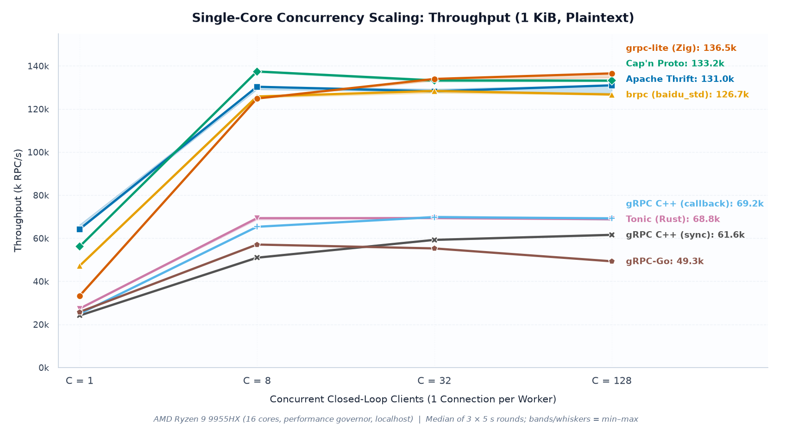
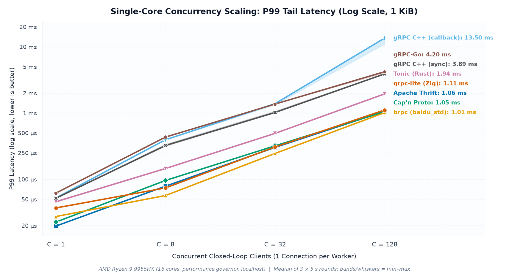
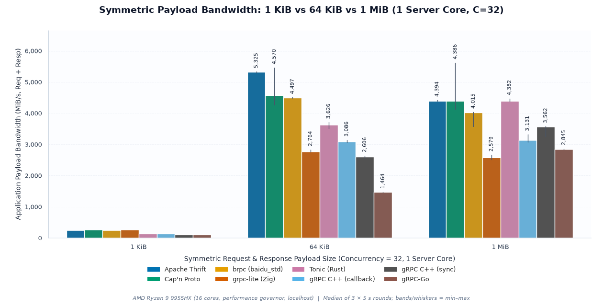
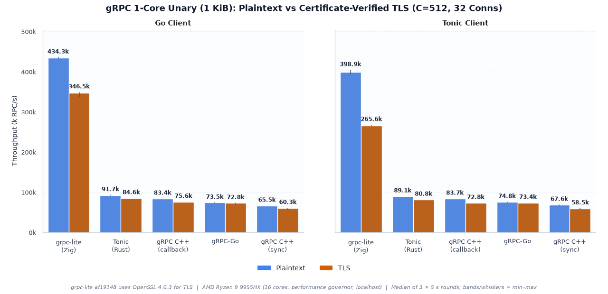
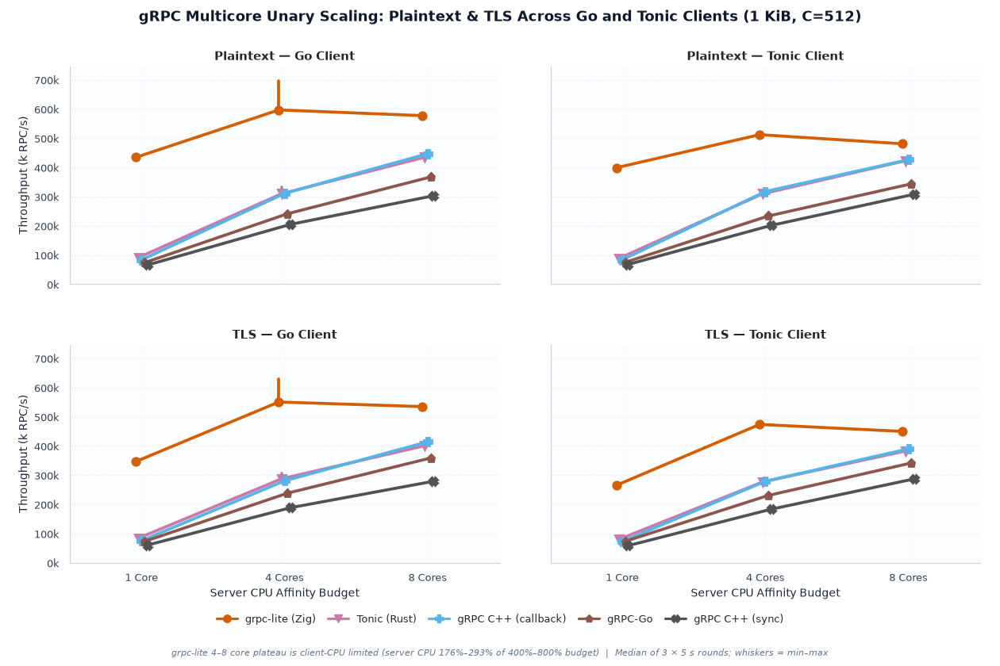
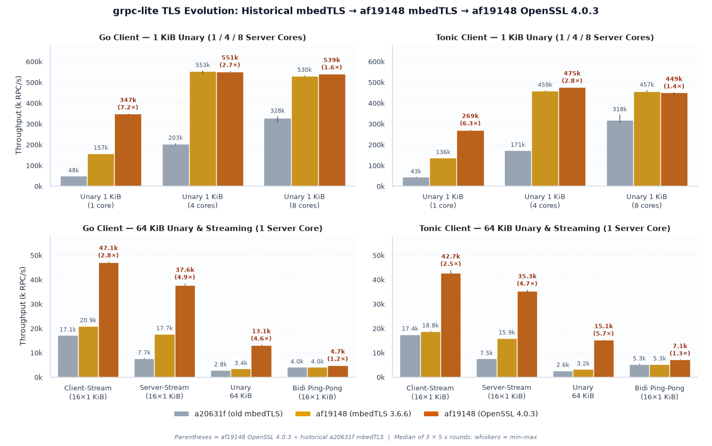

# RPC Framework Performance Report

> **Campaign:** `2026-11-21-full-af19148` &nbsp;|&nbsp; **Formal Runs:** 906 (+ 302 smoke) &nbsp;|&nbsp; **Completed RPCs:** 563,735,713 &nbsp;|&nbsp; **Errors:** 0
>
> **Host:** AMD Ryzen 9 9955HX (16 physical cores / 32 threads, `performance` governor, Linux x86_64, localhost TCP)  
> **Charts:** Generated via [Benchkit](https://github.com/open-sourcing/benchkit) (`benchkit.lwchart`) in both PNG and vector PDF — see [`harness/plot_report.py`](../harness/plot_report.py) to regenerate.

---

## Executive Summary

This report evaluates **8 RPC server stacks** across three independent, zero-error benchmark matrices on the same machine:

1. **Native Cross-Protocol Matrix (360 runs, 191.8M RPCs):** Plaintext closed-loop C++ clients comparing **Apache Thrift**, **Cap'n Proto**, **brpc (`baidu_std`)**, **grpc-lite (`af19148`)**, **Tonic**, **gRPC C++ (callback)**, **gRPC C++ (sync)**, and **gRPC-Go** across latency, concurrency, multicore scaling, large payloads, and asymmetric payloads.
2. **Extended gRPC Matrix (420 runs, 276.2M RPCs):** Five gRPC server configurations tested with both **gRPC-Go** and **Tonic** multi-process load generators across **Plaintext vs. certificate-verified TLS**, **1 / 4 / 8 server cores**, **1 KiB vs. 64 KiB**, and **all 4 RPC modes** (unary, client-stream, server-stream, bidi ping-pong).
3. **`grpc-lite` TLS Backend Evolution (126 runs, 95.8M RPCs):** Controlled same-host comparison of historical `a20631f` (mbedTLS) → `af19148` (mbedTLS 3.6.6) → `af19148` (OpenSSL 4.0.3).

### Headline Findings

| Dimension | Winner in This Setup | Headline Metric (Median of 3 × 5 s Rounds) | Key Takeaway |
| --- | --- | --- | --- |
| **Lowest 1 KiB Latency (C=1, 1 core)** | **Apache Thrift** | **15.5 µs** P50 / **20.1 µs** P99 | Non-HTTP/2 binary protocols (`Thrift`, `Cap'n Proto`, `brpc`) run at roughly half the latency of gRPC stacks. |
| **Fastest gRPC Latency (C=1, 1 core)** | **grpc-lite (Zig)** | **30.0 µs** P50 / **39.1 µs** P99 | Leads all gRPC stacks by 17%–27% on median RTT. |
| **Peak 8-Core Plaintext Throughput (Native)** | **Apache Thrift** | **992.6k RPC/s** (7.7× scaling) | Followed by `Cap'n Proto` (772k) and `brpc` (632k). `grpc-lite` leads gRPC (422k) before hitting a C++ client CPU ceiling. |
| **1-Core gRPC Unary (Plaintext / TLS)** | **grpc-lite (Zig)** | **434k / 347k RPC/s** (Go client) | **4.7×** Tonic in plaintext and **4.1×** Tonic over TLS with OpenSSL 4.0.3 (up **7.18×** from the Nov 16 mbedTLS baseline). |
| **Large Symmetric 1 MiB Payload (1 core)** | **Apache Thrift / Cap'n Proto / Tonic** | **4,394 / 4,386 / 4,382 MiB/s** | `Tonic` matches native protocols at 1 MiB; `grpc-lite` drops to last place (2,579 MiB/s / 1,289 RPC/s). |
| **gRPC Streaming (Plaintext & TLS, 1 core)** | **grpc-lite (Zig)** / **Tonic (Rust)** | **66k** client-stream, **49k** server-stream | `grpc-lite` leads server-streaming by 1.5×–5×; `Tonic` leads Tonic-client TLS client-streaming (48.4k vs 42.7k). |
| **gRPC C++ Callback vs. Sync API** | **Workload-dependent** | **+27%–48%** unary throughput, **3.5×** worse C=128 P99 | Callback wins on throughput across unary/multicore, but its single-core high-concurrency P99 spikes to **13.5 ms** (vs. 3.89 ms sync). |

> **Scope reminder:** These matrices use different client implementations and connection topologies. **Compare frameworks within each matrix**, not by mixing numbers across matrices. Closed-loop localhost runs measure end-to-end client+server stacks, not universal isolated server ceilings.

---

## Testbed & Methodology

### Hardware & Isolation

- **CPU:** AMD Ryzen 9 9955HX — 16 physical cores / 32 threads, `performance` scaling governor verified on CPUs `0–15`.
- **Core pinning:** Clients pinned to physical cores `0–7` (two processes on `0–3` and `4–7` in the extended matrix); servers pinned to distinct physical cores `15` (1 core), `12–15` (4 cores), or `8–15` (8 cores).
- **Measurement protocol:** Every formal configuration runs **3 repetitions × 5 seconds** after warmup (1 s native, 2 s extended). All reported values are **round medians**; shaded bands and whiskers in every Benchkit chart show the **full observed min–max range** across the 3 rounds. Zero RPC or response-length validation errors occurred across all 563.7M calls.
- **No compression, retries, reflection, or request logging.** Payloads are zero-filled and response lengths are validated on every call.

### Tested Software Versions

| Stack | Protocol / API | Version / Commit | Runtime / Build Notes |
| --- | --- | --- | --- |
| **Apache Thrift** | Binary / Framed | `0.25.0` (`27e8a42`) | C++17 Release, nonblocking I/O threads |
| **Cap'n Proto** | Two-party RPC | `1.5.0` (`373e61e`) | C++17 Release, 1 event loop/thread + `SO_REUSEPORT` |
| **brpc** | `baidu_std` | `1.18.0` (`94f1bbd`) | C++17 Release, system protobuf 3.19.6 + OpenSSL 4 patch |
| **grpc-lite** | gRPC / HTTP/2 | `af19148` (Zig 0.17.0) | `ReleaseFast`, `-Dtls=true` (OpenSSL 4.0.3 default; mbedTLS 3.6.6 tested in Part 3) |
| **Tonic** | gRPC / HTTP/2 | `0.14.6` (Rust 1.100.0) | Tokio `1.53.1`, `tls-ring`, Release (`--locked`) |
| **gRPC C++ (callback / sync)** | gRPC / HTTP/2 | `1.84.3` (GCC 16.2.1) | CMake Release, bundled protobuf `35.1.0` & Abseil `20250512` |
| **gRPC-Go** | gRPC / HTTP/2 | `1.82.1` (Go 1.26.2) | Frozen campaign binary; matching `GOMAXPROCS` |

---

## Part 1 — Cross-Protocol Plaintext Comparison (8 Frameworks)

All 8 server configurations are driven by a unified closed-loop C++ load-driver harness (`harness/campaign_native.py`, managed by Benchkit). Each concurrent worker runs on its own native thread with a dedicated persistent connection (no accidental cross-worker multiplexing). All 5 gRPC servers share the exact same C++ gRPC client binary; Thrift, Cap'n Proto, and brpc use their native C++ clients under the same driver contract.

### 1.1 Single-Request Latency (`C = 1`, 1 Server Core)


| Stack | 0 B P50 (µs) | 64 B P50 (µs) | 1 KiB P50 (µs) | 1 KiB P95 (µs) | 1 KiB P99 (µs) | 1 KiB RPC/s |
| --- | ---: | ---: | ---: | ---: | ---: | ---: |
| **Apache Thrift** | 14.6 | 14.8 | **15.5** | 18.6 | **20.1** | 63,632 |
| **Cap'n Proto** | 16.8 | 16.8 | **17.3** | 20.6 | **22.9** | 56,333 |
| **brpc (`baidu_std`)** | 20.3 | 20.5 | **20.8** | 24.3 | **27.7** | 47,102 |
| **grpc-lite (Zig)** | 29.0 | 29.0 | **30.0** | 33.8 | **39.1** | 32,679 |
| **Tonic (Rust)** | 32.2 | 32.3 | **36.2** | 40.3 | **47.0** | 27,245 |
| **gRPC-Go** | 37.1 | 37.3 | **37.8** | 42.7 | **61.2** | 25,798 |
| **gRPC C++ (callback)** | 37.6 | 38.3 | **39.3** | 45.6 | **52.2** | 24,952 |
| **gRPC C++ (sync)** | 39.6 | 40.0 | **41.0** | 45.5 | **52.6** | 24,029 |

**Observations:**
- Wire protocol framing dominates small-message RTT: moving from 0 B to 1 KiB adds only `0.5–4.0 µs`, whereas the baseline gap between Thrift (`15.5 µs`) and HTTP/2+gRPC (`30.0–41.0 µs`) is ~2×.
- Among the five gRPC stacks (all measured with the identical C++ gRPC client), **`grpc-lite` is the fastest** at `30.0 µs` P50 / `39.1 µs` P99.

---

### 1.2 Single-Core Concurrency Scaling (`C = 1 → 128`, 1 KiB)





| Stack | C=1 (k RPC/s) | C=8 (k RPC/s) | C=32 (k RPC/s) | C=128 (k RPC/s) | C=128 P50 (µs) | C=128 P99 (µs) |
| --- | ---: | ---: | ---: | ---: | ---: | ---: |
| **grpc-lite (Zig)** | 33.2 | 124.8 | 133.9 | **136.5** | 933 | 1,111 |
| **Cap'n Proto** | 56.1 | **137.4** | 133.2 | 133.2 | 961 | 1,046 |
| **Apache Thrift** | **64.2** | 130.3 | 128.2 | 131.0 | 975 | 1,062 |
| **brpc (`baidu_std`)** | 47.1 | 125.8 | 128.4 | 126.7 | 946 | **1,013** |
| **gRPC C++ (callback)** | 24.9 | 65.3 | 69.8 | 69.2 | 1,440 | **13,500** |
| **Tonic (Rust)** | 27.3 | 69.3 | 69.3 | 68.8 | 1,885 | 1,943 |
| **gRPC C++ (sync)** | 24.1 | 50.9 | 59.2 | 61.6 | 2,007 | 3,892 |
| **gRPC-Go** | 25.7 | 57.1 | 55.3 | 49.3 | 2,591 | 4,203 |

**Observations:**
- **Two clear performance tiers emerge on 1 server core:** `grpc-lite`, `Cap'n Proto`, `Thrift`, and `brpc` all saturate near **127k–137k RPC/s** with tight, predictable **1.01–1.11 ms P99** at `C=128`. Notably, `grpc-lite` is the only gRPC stack in this upper tier (2× faster than Tonic and C++ callback, 2.8× faster than gRPC-Go).
- **Queueing starts above `C = 8`:** throughput barely rises from `C = 8` to `C = 128`, while P99 climbs linearly with Little's Law (`concurrency / throughput`).
- **Async APIs are not an automatic tail-latency win:** `gRPC C++ (callback)` delivers +12% throughput over `sync` at `C=128`, but its P99 balloons to **13.50 ms** (3.5× worse than `sync` and 12× worse than `grpc-lite`).

---

### 1.3 Multicore Scaling (`1 → 4 → 8` Server Cores, 1 KiB, `C = 128`)


| Stack | 1 Core (RPC/s) | 4 Cores (RPC/s) | 8 Cores (RPC/s) | 8c / 1c Scaling | 8c P99 (µs) | 8c Client / Server CPU % |
| --- | ---: | ---: | ---: | ---: | ---: | ---: |
| **Apache Thrift** | 129,438 | 487,238 | **992,615** | **7.67×** | **243** | 422% / 481% |
| **Cap'n Proto** | 133,175 | **504,145** | 772,100 | 5.80× | 647 | 561% / 355% |
| **brpc (`baidu_std`)** | 127,345 | 447,733 | 632,113 | 4.96× | 254 | 546% / 393% |
| **grpc-lite (Zig)** | **133,856** | 406,484 | 421,511 | 3.15×\* | 822 | **588% / 256%** |
| **gRPC C++ (callback)** | 69,192 | 246,236 | 346,732 | 5.01× | 1,247 | 586% / 519% |
| **Tonic (Rust)** | 68,892 | 274,531 | 306,116 | 4.44× | 1,905 | 496% / 321% |
| **gRPC C++ (sync)** | 62,296 | 183,702 | 291,445 | 4.68× | 1,027 | 506% / 500% |
| **gRPC-Go** | 49,422 | 160,777 | 266,870 | 5.40× | 1,917 | 483% / 578% |

**Observations:**
- **Apache Thrift nearly achieves linear 8-core scaling** (`7.67×`, approaching **1M RPC/s** at `243 µs` P99) while using the lowest client CPU (`422%` out of an 800% budget).
- **\*`grpc-lite` plateaus at 4 → 8 cores because the C++ gRPC client saturates first:** client CPU hits `588%` while server process CPU sits at just `256%` (out of 800%). Even capped by the client, `grpc-lite` remains the highest-throughput gRPC server at `421.5k RPC/s` and lowest 8-core gRPC P99 (`822 µs`).
- `gRPC C++ (callback)` outperforms `Tonic` (+13%), `C++ sync` (+19%), and `gRPC-Go` (+30%) on 8 cores, though its P99 (`1.25 ms`) remains above `C++ sync` (`1.03 ms`).

---

### 1.4 Large Symmetric & Asymmetric Payloads (1 Server Core, `C = 32`)



| Stack | 64 KiB RPC/s | 64 KiB MiB/s | 1 MiB RPC/s | 1 MiB MiB/s | 1 MiB P99 (ms) |
| --- | ---: | ---: | ---: | ---: | ---: |
| **Apache Thrift** | **42,599** | **5,325** | **2,197** | **4,394** | **15.6** |
| **Cap'n Proto** | 36,557 | 4,570 | 2,193 | 4,386 | 16.6 |
| **Tonic (Rust)** | 29,008 | 3,626 | 2,191 | 4,382 | 22.1 |
| **brpc (`baidu_std`)** | 35,977 | 4,497 | 2,007 | 4,015 | 40.8 |
| **gRPC C++ (sync)** | 20,847 | 2,606 | 1,781 | 3,562 | 87.2 |
| **gRPC C++ (callback)** | 24,686 | 3,086 | 1,566 | 3,131 | 111.3 |
| **gRPC-Go** | 11,710 | 1,464 | 1,422 | 2,845 | 142.2 |
| **grpc-lite (Zig)** | 22,115 | 2,764 | 1,289 | 2,579 | 27.7 |


| Stack | 64 B Req → 64 KiB Resp (RPC/s) | 64 KiB Req → 64 B Resp (RPC/s) | Direction Ratio (Large-Req / Large-Resp) |
| --- | ---: | ---: | ---: |
| **Apache Thrift** | 53,445 | **78,205** | 1.46× |
| **brpc (`baidu_std`)** | 51,188 | 66,889 | 1.31× |
| **Cap'n Proto** | **59,931** | 56,681 | 0.95× |
| **Tonic (Rust)** | 42,037 | 48,249 | 1.15× |
| **grpc-lite (Zig)** | 44,262 | 47,345 | 1.07× |
| **gRPC C++ (callback)** | 38,766 | 36,350 | 0.94× |
| **gRPC C++ (sync)** | 37,675 | 34,842 | 0.92× |
| **gRPC-Go** | 16,912 | 20,702 | 1.22× |

**Observations:**
- **Payload size reshuffles the gRPC rankings completely:** at 1 MiB symmetric payloads, **Tonic jumps to 4,382 MiB/s** (statistically tied with Thrift and Cap'n Proto!) with a clean `22.1 ms` P99, whereas `grpc-lite` falls to last place (`2,579 MiB/s`, 59% of Thrift/Tonic) despite dominating small-message gRPC.
- **gRPC C++ & gRPC-Go suffer severe tail latency at 1 MiB** (`87–142 ms` P99 vs. `15.6–27.7 ms` for Thrift, Cap'n Proto, Tonic, and grpc-lite).
- **Direction matters:** Thrift (+46%) and brpc (+31%) absorb large requests significantly faster than generating large responses, while Cap'n Proto leads the large-response case (`59.9k RPC/s`).

---

## Part 2 — Extended gRPC Matrix: Plaintext vs. TLS, Multicore & Streaming

This 420-run matrix tests the **5 gRPC server configurations** under heavy multiplexed load using **two independent load-generator processes** (Go `grpc-go/1.82.1` or Rust `tonic/0.14.6`, pinned to CPUs `0–3` and `4–7`, 32 total connections, concurrency 512 for unary / 32 for streaming). TLS verifies a local CA and `localhost` SAN certificate on every call; stack-default TLS versions and cipher suites are preserved.

### 2.1 Single-Core 1 KiB Unary: Plaintext vs. TLS



| Server | Plaintext — Go Client | Plaintext — Tonic Client | TLS — Go Client | TLS — Tonic Client | TLS Retention (Go / Tonic) |
| --- | ---: | ---: | ---: | ---: | ---: |
| **grpc-lite (Zig, OpenSSL 4.0.3)** | **434,273** | **398,901** | **346,546** | **265,583** | 79.8% / 66.6% |
| **Tonic (Rust, ring)** | 91,721 | 89,096 | 84,607 | 80,773 | 92.2% / 90.7% |
| **gRPC C++ (callback)** | 83,407 | 83,656 | 75,596 | 72,821 | 90.6% / 87.0% |
| **gRPC-Go** | 73,548 | 74,827 | 72,824 | 73,387 | **99.0% / 98.1%** |
| **gRPC C++ (sync)** | 65,500 | 67,645 | 60,285 | 58,494 | 92.0% / 86.5% |

**Observations:**
- **Dramatic TLS turnaround for `grpc-lite`:** In the earlier November 16 run (mbedTLS), `grpc-lite` fell 89% under TLS to last place (`48.7k / 42.7k`). With `af19148` + OpenSSL 4.0.3, `grpc-lite` now delivers **346.5k / 265.6k RPC/s over TLS — 4.1× / 3.3× faster than second-place Tonic**.
- `gRPC-Go` shows the smallest relative TLS penalty (~1–2% drop), largely because Go's non-crypto HTTP/2 and runtime overhead already dominate its single-core cost.

---

### 2.2 Multicore Unary Scaling: Plaintext & TLS (`1 → 4 → 8` Cores, 1 KiB)



| Server | Plaintext 1c (Go / Tonic) | Plaintext 4c (Go / Tonic) | Plaintext 8c (Go / Tonic) | TLS 1c (Go / Tonic) | TLS 4c (Go / Tonic) | TLS 8c (Go / Tonic) |
| --- | ---: | ---: | ---: | ---: | ---: | ---: |
| **grpc-lite (Zig)** | **434k / 399k** | **597k / 512k** | **577k / 481k**\* | **347k / 266k** | **550k / 474k** | **535k / 450k**\* |
| **gRPC C++ (callback)** | 83k / 84k | 311k / 317k | 447k / 426k | 76k / 73k | 281k / 279k | 414k / 390k |
| **Tonic (Rust)** | 92k / 89k | 310k / 309k | 435k / 423k | 85k / 81k | 288k / 277k | 401k / 383k |
| **gRPC-Go** | 74k / 75k | 241k / 233k | 367k / 344k | 73k / 73k | 238k / 230k | 359k / 342k |
| **gRPC C++ (sync)** | 66k / 68k | 205k / 201k | 303k / 308k | 60k / 58k | 188k / 183k | 279k / 287k |

*\*`grpc-lite` at 4 and 8 cores is load-generator-limited in this 8-client-core setup: server process CPU is only `176%–293%` (out of 400%–800% budget). Its true 8-core server ceiling cannot be established here.*

**Observations:**
- `gRPC C++ (callback)` and `Tonic` track almost identically from 1 to 8 cores in both plaintext and TLS, with `C++ callback` edging ahead by ~2–3% at 8 cores (`447k` vs `435k` plaintext; `414k` vs `401k` TLS).
- `C++ callback` beats `C++ sync` by **+48%** on 8 cores in plaintext (`447k` vs `303k`) and **+48%** in TLS (`414k` vs `279k`).

---

### 2.3 Streaming Modes: Client-Stream, Server-Stream & Bidi Ping-Pong (1 Core, `16 × 1 KiB`)

Each operation is **one complete streaming RPC** (stream setup, 16 messages or 16 ping-pong exchanges, half-close, and terminal `OK` status). Multiply by 16 for streaming message/s (32 application messages/RPC for bidi).


| Mode | Server | Plaintext (Go / Tonic RPC/s) | TLS (Go / Tonic RPC/s) |
| --- | --- | ---: | ---: |
| **Client-Stream** | **grpc-lite (Zig)** | **66,015** / **61,083** | **47,056** / 42,750 |
| **Client-Stream** | **Tonic (Rust)** | 43,481 / 59,885 | 35,491 / **48,414** |
| **Client-Stream** | **gRPC-Go** | 31,702 / 34,278 | 30,370 / 33,955 |
| **Client-Stream** | **gRPC C++ (callback)** | 26,138 / 29,809 | 22,483 / 25,450 |
| **Client-Stream** | **gRPC C++ (sync)** | 26,308 / 28,937 | 22,444 / 25,057 |
| **Server-Stream** | **grpc-lite (Zig)** | **46,336** / **48,833** | **38,469** / **35,251** |
| **Server-Stream** | **gRPC-Go** | 31,247 / 29,910 | 27,333 / 25,914 |
| **Server-Stream** | **Tonic (Rust)** | 7,649 / 8,936 | 7,480 / 8,364 |
| **Server-Stream** | **gRPC C++ (sync)** | 8,466 / 8,730 | 7,517 / 7,888 |
| **Server-Stream** | **gRPC C++ (callback)** | 8,023 / 8,655 | 7,625 / 7,755 |
| **Bidi Ping-Pong** | **grpc-lite (Zig)** | 4,786 / **8,986** | 4,797 / **7,083** |
| **Bidi Ping-Pong** | **gRPC-Go** | **5,775** / 5,722 | **5,272** / 4,898 |
| **Bidi Ping-Pong** | **Tonic (Rust)** | 4,152 / 7,156 | 4,361 / 6,421 |
| **Bidi Ping-Pong** | **gRPC C++ (callback)** | 3,087 / 5,746 | 2,681 / 4,727 |
| **Bidi Ping-Pong** | **gRPC C++ (sync)** | 2,668 / 4,359 | 2,376 / 3,731 |

**Observations:**
- **Server-streaming separates transport-pipelined servers from per-message-buffered handlers:** `grpc-lite` (`46k–49k` plaintext / `35k–38k` TLS) and `gRPC-Go` (`30k–31k` / `26k–27k`) far outpace `Tonic` and `gRPC C++` (`7.5k–8.9k`), where handler implementations send through a 1-slot bounded channel (Tonic) or 1-write-at-a-time reactor step (C++ callback).
- **Client-streaming shows strong client-server affinity:** `grpc-lite` leads with the Go client in both plaintext and TLS, whereas `Tonic` matches it in plaintext and overtakes it in TLS (`48.4k` vs `42.7k`) when paired with the Tonic client.
- **Bidi ping-pong is latency-bound and client-sensitive:** `gRPC-Go` leads under the Go client (`5.78k / 5.27k`), while `grpc-lite` leads under the Tonic client (`8.99k / 7.08k`).

---

### 2.4 Large 64 KiB Unary: Plaintext vs. TLS (1 Core)


| Server | Plaintext (Go / Tonic RPC/s) | TLS (Go / Tonic RPC/s) |
| --- | ---: | ---: |
| **gRPC C++ (callback)** | 14,552 / **28,692** | **14,664** / **19,460** |
| **gRPC C++ (sync)** | 14,079 / 24,634 | 10,953 / 14,500 |
| **grpc-lite (Zig)** | **14,764** / 20,912 | 13,217 / 15,062 |
| **Tonic (Rust)** | 14,326 / 20,366 | 13,953 / 15,240 |
| **gRPC-Go** | 7,032 / 9,444 | 6,741 / 7,423 |

**Observations:**
- Under the Tonic client (which drives higher large-message offered load than Go), **`gRPC C++ (callback)` leads both Plaintext (`28.7k`) and TLS (`19.5k`)**, while `grpc-lite` and `Tonic` sit in a virtual tie (~20–21k plaintext, ~15.1–15.2k TLS).
- Compared to November 16 (when `grpc-lite` mbedTLS managed only `2.8k / 2.6k` at 64 KiB TLS), OpenSSL 4.0.3 lifted `grpc-lite` by **4.6×–5.7×** right back into parity with Tonic and C++ sync.

---

## Part 3 — `grpc-lite` TLS Backend Evolution

To separate general `grpc-lite` improvements (`a20631f` → `af19148`) from the TLS library switch (mbedTLS → OpenSSL 4.0.3), a dedicated 126-run controlled comparison rotated all three builds on the same host under identical certificates, affinity, and load generators.



| TLS Workload (Go / Tonic) | `a20631f` (Old mbedTLS) | `af19148` (mbedTLS 3.6.6) | `af19148` (OpenSSL 4.0.3) | Total Upgrade (OpenSSL / Old) | Same-Commit OpenSSL / mbedTLS |
| --- | ---: | ---: | ---: | ---: | ---: |
| **Unary 1 KiB, 1 core** | 48.3k / 43.0k | 156.9k / 136.0k | **346.9k / 269.4k** | **7.18× / 6.27×** | **2.21× / 1.98×** |
| **Unary 1 KiB, 4 cores** | 202.6k / 170.8k | **552.5k** / 459.0k | 550.5k / **475.3k** | 2.72× / 2.78× | 1.00× / 1.04× |
| **Unary 1 KiB, 8 cores** | 327.8k / 318.2k | 530.4k / **456.5k** | **539.1k** / 449.0k | 1.65× / 1.41× | 1.02× / 0.98× |
| **Unary 64 KiB, 1 core** | 2.8k / 2.6k | 3.4k / 3.2k | **13.1k / 15.1k** | **4.64× / 5.72×** | **3.88× / 4.75×** |
| **Client-Stream, 1 core** | 17.1k / 17.4k | 20.9k / 18.8k | **47.1k / 42.7k** | **2.76× / 2.46×** | **2.25× / 2.27×** |
| **Server-Stream, 1 core** | 7.7k / 7.5k | 17.7k / 15.9k | **37.6k / 35.3k** | **4.91× / 4.71×** | **2.13× / 2.21×** |
| **Bidi Ping-Pong, 1 core** | 4.0k / 5.3k | 4.0k / 5.3k | **4.7k / 7.1k** | 1.19× / 1.34× | 1.19× / 1.34× |

**Observations:**
- **Two distinct compounding wins:** Upgrading `grpc-lite` from `a20631f` to `af19148` alone boosted 1-core TLS unary by **3.2×** even while staying on mbedTLS (`48k → 157k`). Switching the TLS backend to OpenSSL 4.0.3 delivered an additional **2.0×–2.2×** on small messages/streaming and **3.9×–4.8×** on 64 KiB payloads!
- At 4 and 8 server cores, both `af19148` backends saturate the Go/Tonic load generators (~540k–553k Go / ~449k–475k Tonic), so neither backend has a measurable edge at those fixed client loads.

---

## Practical Framework Selection Guide

| Use Case | Strongest Candidates | Rationale from Measured Data |
| --- | --- | --- |
| **Ultra-low latency & peak multicore throughput (non-gRPC OK)** | **Apache Thrift**, **Cap'n Proto**, **brpc** | 15.5–20.8 µs P50, 632k–993k RPC/s on 8 cores, tight 243–647 µs 8-core P99. |
| **Small-message gRPC (Plaintext & TLS) & high-rate streaming** | **grpc-lite (Zig)** | Fastest gRPC latency (30 µs P50), 3.3×–4.7× higher 1-core unary RPC/s (plaintext & OpenSSL TLS), leads server-streaming. *Caveat: 1 MiB symmetric throughput currently trails peers.* |
| **Balanced production Rust gRPC across small + large payloads** | **Tonic (Rust)** | Strong all-rounder: matches Thrift/Cap'n Proto on 1 MiB bandwidth (4,382 MiB/s), tight C=128 tail latency (1.94 ms), solid TLS retention (91%–92%). |
| **High-throughput C++ gRPC with large payloads or multicore** | **gRPC C++ (callback)** | Leads 64 KiB extended gRPC (`28.7k` plaintext / `19.5k` TLS with Tonic client) and scales to `447k` on 8 cores. *Caveat: monitor P99 under high single-core saturation (13.5 ms at C=128).* |
| **Go ecosystem gRPC with minimal TLS overhead** | **gRPC-Go** | Only 1–2% TLS penalty on 1 core and strong server-streaming (`31k` plaintext / `27k` TLS), though lower unary ceiling and slower at 64 KiB. |

---

## Variability, Limits & Reproducibility

### Known Variability & Methodological Limits
- **Run-to-run spread:** Most groups exhibit `<3%` `(max - min) / median` spread across 3 rounds. The largest spreads appear in Cap'n Proto (`SO_REUSEPORT` kernel connection skew: 26% at 64 KiB, 34% at 1 MiB, 29% asymmetric) and brpc at 1 MiB (11.6%). All charts display exact observed min–max whiskers/bands so variance is transparent.
- **Closed-loop measurement:** Does not correct for coordinated omission. Throughput includes in-flight calls drained after the 5 s deadline.
- **Localhost TCP only:** Excludes physical NIC latency, packet loss, MTU fragmentation across switches, and NUMA/cross-host effects.
- **Client ceilings:** `grpc-lite` on 4–8 cores hits client-side CPU limits in both the native C++ matrix and the extended Go/Tonic matrix.
- **Non-gRPC scope:** TLS and streaming were measured for the 5 gRPC stacks only, not for Thrift, Cap'n Proto, or brpc.
- **Aggregate latency:** Multi-process extended runs intentionally keep aggregate latency percentiles `null` rather than invalidly merging independent client histograms.

### Reproducing the Benchkit Graphs

All 11 figures (PNG + vector PDF) in [`report/figures/`](figures/) are deterministically generated from the raw campaign data using Benchkit's `lwchart` engine:

```sh
/tmp/opencode/rpc-benchkit-venv/bin/python harness/plot_report.py \
  --dataset results/2026-11-21-full-af19148 \
  --output report/figures
```

Raw provenance files (binary SHA-256 manifests, `lscpu`, compiler versions, CPU governors, compressed host telemetry, and all per-run CSV/JSONL records) are preserved under [`results/2026-11-21-full-af19148/`](../results/2026-11-21-full-af19148/).
