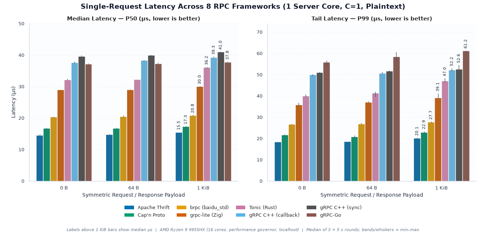
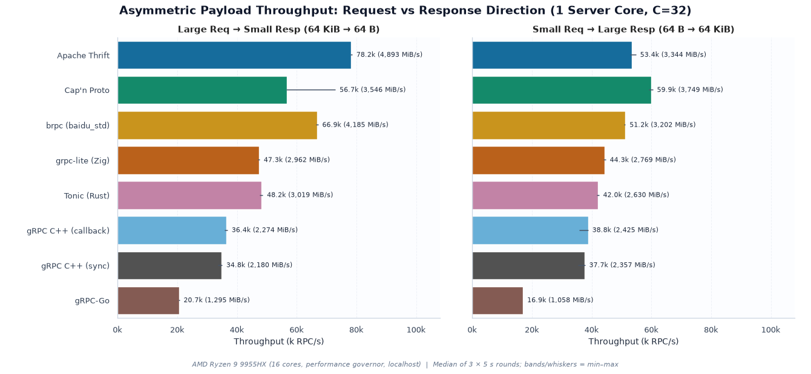
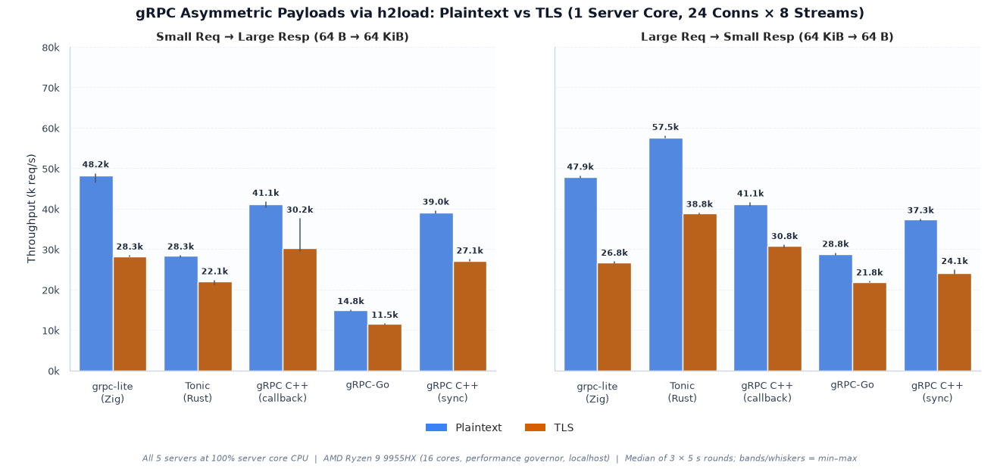

# RPC Framework Performance Report

> **Campaign:** [`2026-11-25-h2load-0f6c850`](../results/2026-11-25-h2load-0f6c850/README.md) &nbsp;|&nbsp; **Formal Runs:** 780 (+ 260 smoke) &nbsp;|&nbsp; **Completed RPCs:** 524,313,126 &nbsp;|&nbsp; **Errors:** 0
>
> **Host:** AMD Ryzen 9 9955HX (16 physical cores / 32 threads, `performance` governor, Linux x86_64, localhost TCP)  
> **Primary gRPC Load Generator:** Off-the-shelf **`h2load` (`nghttp2/1.69.0`)** for all Unary scenarios (zero custom client bias, 92%–100% server saturation); Go (`1.83.2`) & Tonic (`0.14.6`) clients for Streaming; native C++ clients for Thrift, Cap'n Proto, and brpc.  
> **Charts:** Generated via [Benchkit](https://github.com/open-s4c/benchkit) (`benchkit.lwchart`) in both PNG and vector PDF — see [`harness/plot_report.py`](../harness/plot_report.py) to regenerate.

---

## Executive Summary

This report evaluates **8 RPC server stacks** (`grpc-lite 0f6c850` with OpenSSL 4.0.3, `Tonic 0.14.6`, `gRPC C++ 1.84.3` callback & sync, `gRPC-Go 1.83.2`, `Apache Thrift 0.25.0`, `Cap'n Proto 1.5.0`, and `brpc 1.18.0`) using neutral third-party **`h2load` (`nghttp2/1.69.0`)** across all gRPC Unary matrices so fast servers are never capped by Go, Tonic, or blocking C++ client CPU ceilings:

1. **Part 1 — Cross-Protocol Plaintext Matrix (360 formal runs, 216.8M RPCs):** 8 frameworks compared under identical **1-connection-per-worker (`-m 1`)** closed-loop topology (`Thrift`, `Cap'n Proto`, `brpc` on native C++ clients; all 5 gRPC servers on `h2load -m 1`) across latency (`0 B / 64 B / 1 KiB`), concurrency (`C = 1 → 128`), multicore (`1 / 4 / 8` cores), large payloads (`1 KiB / 64 KiB / 1 MiB`), and asymmetric payloads (`64 B ↔ 64 KiB`).
2. **Part 2 — Multiplexed gRPC Plaintext vs. TLS Matrix via `h2load` (240 formal runs, 286.7M RPCs):** All 5 gRPC servers driven to **92%–100% server core saturation** across `1 / 2 / 4 / 8` server cores (`12` client cores for `1–4c`, `8` client cores for `8c`, `-m 16`), large symmetric payloads (`64 KiB`, `1 MiB`), and asymmetric payloads (`64 B ↔ 64 KiB`) in both Plaintext (`h2c`) and TLS (`h2`).
3. **Part 3 — gRPC Streaming Matrix (180 formal runs, 20.9M RPCs):** All 5 gRPC servers tested across `client-stream`, `server-stream`, and `bidi` ping-pong (`16 × 1 KiB`/RPC, Plaintext & TLS) using Go (`1.83.2`) and Tonic (`0.14.6`) dual-process load generators (since `h2load` only supports HTTP/2 unary).

### Headline Findings

| Dimension | Winner in This Setup | Headline Metric (Median of 3 × 5 s Rounds) | Key Takeaway |
| --- | --- | --- | --- |
| **Lowest 1 KiB Latency (C=1, 1 core, `-m 1`)** | **Apache Thrift** / **grpc-lite** | **15.6 µs** / **16.0 µs** P50 (`21.3 / 22.0 µs` P99) | Removing blocking C++ gRPC client overhead (`~14 µs`) puts **`grpc-lite` in a virtual tie with raw framed binary Thrift** and ahead of Cap'n Proto (`17.6 µs`) and brpc (`20.9 µs`). |
| **Peak 8-Core Plaintext (`C=128`, `-m 1`)** | **grpc-lite (Zig)** | **1,069,242 RPC/s** (`8.13×`, **`159 µs`** P99) | Even without HTTP/2 multiplexing (`-m 1`), **`grpc-lite` surpasses 1M RPC/s and beats Apache Thrift (`983.6k`, `226 µs` P99), Cap'n Proto (`771.5k`), and brpc (`637.2k`)**. |
| **Multiplexed gRPC Multicore (`h2load`, 4c / 8c)** | **grpc-lite (Zig)** | **1.80M / 2.48M** PT · **1.53M / 2.18M** TLS | In the 8-core configuration, throughput is **4.1× / 3.9×** Tonic's (`604k / 552k`), with **`1.35–2.86 ms` P99** at a concurrency limit of 1,536 streams. |
| **Large Symmetric 64 KiB / 1 MiB (8 Frameworks, `-m 1`)** | **Apache Thrift** | **5,214 MiB/s** (64 KiB) · **4,441 MiB/s** (1 MiB) | Non-HTTP/2 binary protocols (`Thrift`, `brpc`, `Cap'n Proto`) lead bulk plaintext bandwidth; among gRPC stacks, `grpc-lite` leads 64 KiB (`3,004 MiB/s`) while `gRPC-Go` / `C++ callback` lead 1 MiB (`3,314 / 3,209 MiB/s`). |
| **Large Symmetric 64 KiB / 1 MiB gRPC (`h2load`, PT & TLS)** | **gRPC C++ (callback)** | **3,431 / 2,329 MiB/s** (64 KiB) · **3,595 / 2,262 MiB/s** (1 MiB) | `C++ callback` leads throughput on both 64 KiB and 1 MiB in PT & TLS; `Tonic` takes #2 in TLS (`2,049 / 2,206 MiB/s`), while `grpc-lite` delivers **4×–7× tighter P99** (`9–14 ms` @ 64 KiB, `34–51 ms` @ 1 MiB vs `75–362 ms` for C++/Go). |
| **Asymmetric 64 B ↔ 64 KiB gRPC (`h2load`, PT & TLS)** | **grpc-lite** (Resp) / **Tonic** (Req) | **47.0k** PT (`64B→64K`) · **57.2k / 38.6k** (`64K→64B`) | `grpc-lite` leads large-response PT (`47.0k`) and ties `C++ callback` in TLS (`28.3k` vs `29.3k`, 9× tighter P99); **`Tonic` dominates large-request ingestion** in both PT (`57.2k`) and TLS (`38.6k`). |
| **gRPC Server-Streaming (1 core, 16×1 KiB)** | **Tonic (Rust)** | **44.7k / 53.1k** PT · **39.1k / 43.9k** TLS | Leads all 4 client/transport cells ahead of `grpc-lite` (`44.5k / 48.0k` PT, `37.5k / 34.5k` TLS) and `gRPC-Go` (`39.0k / 36.9k` PT, `31.0k / 29.7k` TLS). |
| **gRPC Client-Streaming & Bidi (1 core, 16×1 KiB)** | **grpc-lite** / **Tonic** / **gRPC-Go** | **68.4k** client-stream · **8.80k** bidi (Tonic cli) | `grpc-lite` leads Go-client client-stream (`68.4k / 47.7k`) and Tonic-client bidi (`8.80k / 6.98k`); `Tonic` leads Tonic-client TLS client-stream (`47.7k`); `gRPC-Go` leads Go-client bidi (`5.83k / 5.40k`). |

> **Why switching gRPC Unary to neutral `h2load` mattered:** In earlier runs using the blocking C++ `grpc-native` client and Go/Tonic load generators, client-side overhead added ~`14 µs` of RTT and saturated all 8 client cores (`778%–784% / 800%`), artificially capping 4–8 core `grpc-lite` at `425k–606k` (and clipping `Tonic` at `428k`). The same third-party `h2load` client achieved higher throughput without using `grpc-lite`'s own client.

---

## Testbed & Methodology

### Hardware, Isolation & Validation

- **CPU:** AMD Ryzen 9 9955HX — 16 physical cores / 32 threads, `performance` scaling governor verified on CPUs `0–15`.
- **Core pinning:**
  - **Part 1 (Native + `h2load -m 1`):** Clients pinned to physical cores `0–7`; servers pinned to `15` (1c), `12–15` (4c), or `8–15` (8c).
  - **Part 2 (Multiplexed `h2load`):** `1 / 2 / 4` server cores (`15`, `14–15`, `12–15`) paired with **12 client cores (`0–11`)**; `8` server cores (`8–15`) paired with **8 client cores (`0–7`)**.
  - **Part 3 (Streaming):** Two load-generator processes on `0–3` and `4–7`; server pinned to `15`.
- **Strict zero-error & wire-level validation:** Before every `h2load` run, a pre-flight `curl` HTTP/2 call verifies `HTTP/2 200`, trailer `grpc-status: 0`, and exact Protobuf response byte length (with CA verification on `localhost` for TLS). Every `h2load` run requires `0 failed / 0 errored / 0 timeout`, zero non-`2xx` status codes, and full aggregate byte counts. All native C++ and Go/Tonic streaming clients validate exact response lengths, streaming message counts, aggregate bytes, and terminal `OK` status on every RPC.
- **Measurement protocol:** Every formal configuration runs **3 repetitions × 5 seconds** after warmup (`1 s` Part 1, `2 s` Parts 2 & 3). All tables report **round medians**; every Benchkit chart displays the **full observed min–max range**. Median three-round spread is **1.15%** (Part 1), **1.62%** (Part 2), and **0.75%** (Part 3).

### Tested Software Versions

| Stack | Protocol / API | Version / Commit | Runtime / Build Notes |
| --- | --- | --- | --- |
| **`h2load` (Unary Client)** | HTTP/2 + gRPC wire | `nghttp2/1.69.0` | System Fedora 45 package, OpenSSL 4.0.3 |
| **Apache Thrift** | Binary / Framed | `0.25.0` | C++17 Release, nonblocking I/O threads |
| **Cap'n Proto** | Two-party RPC | `1.5.0` | C++17 Release, pre-bound `SO_REUSEPORT` (`TCP_NODELAY`) |
| **brpc** | `baidu_std` | `1.18.0` | C++17 Release, system protobuf + OpenSSL 4 patch |
| **grpc-lite** | gRPC / HTTP/2 | `0f6c850` (Zig 0.17.0) | `ReleaseFast`, `-Dtls=true` (OpenSSL 4.0.3) + interop patch |
| **Tonic** | gRPC / HTTP/2 | `0.14.6` (Rust 1.100.0) | Tokio `1.53.1`, `tls-ring`, Release (`--locked`) |
| **gRPC C++ (callback / sync)** | gRPC / HTTP/2 | `1.84.3` (GCC 16.2.1) | CMake Release, bundled protobuf & Abseil, `SERVER_THREADS` tuned |
| **gRPC-Go** | gRPC / HTTP/2 | `1.83.2` (Go 1.26.2) | Frozen campaign binary; matching `GOMAXPROCS` |

---

## Part 1 — Cross-Protocol Plaintext Comparison (8 Frameworks, `-m 1`)

All 8 frameworks run under an identical **1-connection-per-worker closed-loop topology** ([`harness/campaign_native.py`](../harness/campaign_native.py), managed by Benchkit): `Apache Thrift`, `Cap'n Proto`, and `brpc` use their native C++ clients (`1` thread / `1` socket per worker), while all 5 gRPC servers use neutral **`h2load` (`nghttp2/1.69.0`) with strict `-m 1`** (`1` in-flight RPC per TCP connection, `-t min(8, C) -c C -m 1`).

### 1.1 Single-Request Latency (`C = 1`, 1 Server Core)



| Stack | 0 B P50 (µs) | 64 B P50 (µs) | 1 KiB P50 (µs) | 1 KiB P95 (µs) | 1 KiB P99 (µs) | 1 KiB RPC/s |
| --- | ---: | ---: | ---: | ---: | ---: | ---: |
| **Apache Thrift** | **14.9** | **15.1** | **15.6** | **18.8** | **21.3** | **62,772** |
| **grpc-lite (Zig)** | 16.0 | 16.0 | **16.0** | 20.0 | **22.0** | 55,140 |
| **Cap'n Proto** | 16.9 | 17.2 | 17.6 | 20.9 | 23.5 | 55,424 |
| **brpc (`baidu_std`)** | 20.4 | 20.5 | 20.9 | 24.8 | 28.9 | 46,861 |
| **Tonic (Rust)** | 19.0 | 19.0 | 22.0 | 25.0 | 29.0 | 41,084 |
| **gRPC-Go (`1.83.2`)** | 22.0 | 22.0 | 22.0 | 26.0 | 44.0 | 40,476 |
| **gRPC C++ (callback)** | 23.0 | 23.0 | 24.0 | 32.0 | 36.0 | 37,352 |
| **gRPC C++ (sync)** | 26.0 | 26.0 | 27.0 | 30.0 | 35.0 | 34,753 |

**Observations:**
- **HTTP/2 + gRPC does NOT inherently cost 2× latency:** once blocking C++ gRPC client overhead is removed, **`grpc-lite` hits `16.0 µs` P50 / `22.0 µs` P99** — matching `Apache Thrift` (`15.6 / 21.3 µs`) within `0.4 µs` and beating `Cap'n Proto` (`17.6 / 23.5 µs`) and `brpc` (`20.9 / 28.9 µs`)!
- Every gRPC server dropped by `~13.8–15.6 µs` vs. the legacy sync `grpc-native` client: `Tonic` and `gRPC-Go` both achieve `22.0 µs` P50 (with `Tonic` holding a much tighter `29.0 µs` P99 vs `44.0 µs` for Go), while `gRPC C++ callback` (`24.0 µs`) edges out `sync` (`27.0 µs`).

---

### 1.2 Single-Core Concurrency Scaling (`C = 1 → 128`, 1 KiB)


| Stack | C=1 (k RPC/s) | C=8 (k RPC/s) | C=32 (k RPC/s) | C=128 (k RPC/s) | C=128 P50 (µs) | C=128 P99 (µs) |
| --- | ---: | ---: | ---: | ---: | ---: | ---: |
| **grpc-lite (Zig)** | 56.0 | 129.4 | **134.6** | **132.2** | **962** | 1,130 |
| **Cap'n Proto** | 56.5 | **135.5** | 132.0 | 129.8 | 985 | 1,073 |
| **Apache Thrift** | **63.8** | 128.0 | 128.3 | 127.1 | 1,001 | 1,094 |
| **brpc (`baidu_std`)** | 47.5 | 123.8 | 125.9 | 125.0 | 967 | **1,030** |
| **gRPC C++ (callback)** | 37.5 | 65.7 | 70.3 | 70.8 | 1,700 | **5,820** |
| **Tonic (Rust)** | 41.3 | 69.8 | 69.4 | 68.5 | 1,890 | 1,950 |
| **gRPC-Go (`1.83.2`)** | 40.6 | 69.6 | 66.2 | 63.8 | 1,980 | 3,530 |
| **gRPC C++ (sync)** | 34.8 | 50.9 | 60.2 | 62.8 | 1,980 | 3,750 |

**Observations:**
- **Two sharp single-core tiers:** `grpc-lite`, `Cap'n Proto`, `Thrift`, and `brpc` all saturate near **125k–135k RPC/s** with razor-tight **1.03–1.13 ms P99** at `C=128` (`grpc-lite` is the sole gRPC stack in this upper tier, ~2× faster than Tonic/C++/Go).
- Under `h2load -m 1`, `gRPC-Go` jumps from `52.4k → 63.8k` at `C=128` and `gRPC C++ (callback)`'s `C=128` P99 drops nearly in half (`11.17 ms → 5.82 ms`), though `Tonic` retains the tightest Tier-2 tail latency (`1.95 ms` P99, practically equal to its `1.89 ms` P50).

---

### 1.3 Multicore Scaling (`1 → 4 → 8` Server Cores, 1 KiB, `C = 128`, `-m 1`)


| Stack | 1 Core (RPC/s) | 4 Cores (RPC/s) | 8 Cores (RPC/s) | 8c / 1c Scaling | 8c P99 (µs) | 8c Client / Server CPU % |
| --- | ---: | ---: | ---: | ---: | ---: | ---: |
| **grpc-lite (Zig)** | **131,517** | **548,392** | **1,069,242** | **8.13×** | **159** | 489% / 515% |
| **Apache Thrift** | 127,732 | 486,448 | 983,616 | 7.70× | 226 | 433% / 509% |
| **Cap'n Proto** | 129,962 | 497,809 | 771,516 | 5.94× | 637 | 571% / 372% |
| **brpc (`baidu_std`)** | 124,800 | 443,854 | 637,172 | 5.11× | 248 | 556% / 404% |
| **Tonic (Rust)** | 68,922 | 266,449 | 510,676 | 7.41× | 466 | 362% / 514% |
| **gRPC C++ (callback)** | 70,206 | 247,519 | 446,897 | 6.37× | 1,240 | 256% / 549% |
| **gRPC-Go (`1.83.2`)** | 63,890 | 217,162 | 405,125 | 6.34× | 1,280 | 232% / 608% |
| **gRPC C++ (sync)** | 63,169 | 221,291 | 396,806 | 6.28× | 751 | 225% / 559% |

**Observations:**
- **`grpc-lite` takes #1 overall across all 8 RPC frameworks** once freed from the blocking C++ client: scaling **`8.13×`** (slight super-linearity from better L2/L3 cache residency per reactor at 8 cores) to **`1,069,242 RPC/s`** at **`159 µs` P99**, beating **Apache Thrift** (`983.6k`, `226 µs`), **Cap'n Proto** (`771.5k`), and **brpc** (`637.2k`) — even with HTTP/2 multiplexing disabled (`-m 1`)!
- **Every other gRPC stack also jumped sharply on 8 cores:** `Tonic` climbed from `306k → 510.7k` (`7.41×`, `466 µs` P99), `gRPC C++ callback` from `344k → 446.9k`, `gRPC-Go` from `283k → 405.1k`, and `gRPC C++ sync` from `374k → 396.8k` (`751 µs` P99).

---

### 1.4 Large Symmetric & Asymmetric Payloads (1 Server Core, `C = 32`, `-m 1`)


| Stack | 64 KiB RPC/s | 64 KiB MiB/s | 1 MiB RPC/s | 1 MiB MiB/s | 1 MiB P99 (ms) |
| --- | ---: | ---: | ---: | ---: | ---: |
| **Apache Thrift** | **41,709** | **5,214** | **2,220** | **4,441** | **15.4** |
| **brpc (`baidu_std`)** | 35,553 | 4,444 | 1,872 | 3,744 | 43.4 |
| **Cap'n Proto** | 33,133 | 4,142 | 1,765 | 3,530 | 20.6 |
| **gRPC-Go (`1.83.2`)** | 12,062 | 1,508 | 1,657 | 3,314 | 131.0 |
| **gRPC C++ (callback)** | 21,936 | 2,742 | 1,604 | 3,209 | 124.7 |
| **gRPC C++ (sync)** | 20,316 | 2,540 | 1,536 | 3,072 | 112.7 |
| **Tonic (Rust)** | 20,035 | 2,504 | 1,422 | 2,844 | 32.9 |
| **grpc-lite (Zig)** | 24,031 | 3,004 | 1,307 | 2,613 | 25.5 |



| Stack | 64 B Req → 64 KiB Resp (RPC/s) | 64 KiB Req → 64 B Resp (RPC/s) | Direction Ratio (Large-Req / Large-Resp) |
| --- | ---: | ---: | ---: |
| **Apache Thrift** | 53,411 | **76,988** | 1.44× |
| **brpc (`baidu_std`)** | 51,447 | 66,465 | 1.29× |
| **Cap'n Proto** | **56,606** | 52,882 | 0.93× |
| **grpc-lite (Zig)** | 38,107 | 41,739 | 1.10× |
| **Tonic (Rust)** | 25,041 | 45,342 | **1.81×** |
| **gRPC C++ (callback)** | 36,426 | 31,967 | 0.88× |
| **gRPC C++ (sync)** | 36,235 | 34,808 | 0.96× |
| **gRPC-Go (`1.83.2`)** | 18,779 | 21,669 | 1.15× |

**Observations:**
- **At 64 KiB and 1 MiB, framing overhead shrinks and memory-copy / HTTP/2 flow-control mechanics take over:** `Apache Thrift` leads both 64 KiB (`5,214 MiB/s`) and 1 MiB (`4,441 MiB/s`, `15.4 ms` P99).
- Among the 5 gRPC stacks at `-m 1`: `grpc-lite` leads 64 KiB (`3,004 MiB/s`) and maintains the tightest 1 MiB P99 (`25.5 ms` vs `112.7–131.0 ms` for C++/Go), whereas `gRPC-Go` (`3,314 MiB/s`) and `gRPC C++ callback` (`3,209 MiB/s`) achieve higher 1 MiB throughput at the cost of 4×–5× worse tail latency.

---

## Part 2 — Multiplexed gRPC Plaintext vs. TLS Matrix via `h2load`

This 240-run matrix ([`harness/campaign_h2load.py`](../harness/campaign_h2load.py)) tests all **5 gRPC server configurations** under realistic **HTTP/2 multiplexing** using off-the-shelf **`h2load` (`nghttp2/1.69.0`)** in both Plaintext (`h2c`) and TLS (`h2`, OpenSSL). Across all 240 runs (**286.7M RPCs, 0 errors**), every server reached **92%–100% server core utilization** while `h2load` preserved client CPU headroom.

### 2.1 Multicore 1 KiB Unary Scaling: Plaintext & TLS (`1 → 2 → 4 → 8` Server Cores)


All five servers share the same client settings within each column. The 1- and 2-core configurations use 48 connections; the 4- and 8-core configurations use 96. At 16 concurrent streams per connection, the load limit doubles from 768 to 1,536 streams. From 4 to 8 server cores, connections stay fixed but `h2load` drops from 12 threads on 12 client cores to 8 threads on 8 cores. The `4c / 1c` and `8c / 1c` columns compare end-to-end configurations rather than isolating the effect of server core count.

#### Plaintext (`h2c`, 1 KiB Unary)

| Server | 1c (12c cli) | 2c (12c cli) | 4c (12c cli) | 8c (8c cli) | 4c / 1c | 8c / 1c | 8c P50 / P99 (ms) | 8c Srv / Cli Core CPU % |
| --- | ---: | ---: | ---: | ---: | ---: | ---: | ---: | ---: |
| **grpc-lite (Zig)** | **457,342** | **899,941** | **1,799,087** | **2,483,664** | **3.93×** | 5.43× | **0.48 / 2.86** | 740% / 641% |
| **Tonic (Rust)** | 88,744 | 172,701 | 339,348 | 603,532 | 3.82× | 6.80× | 2.31 / 7.08 | 781% / 361% |
| **gRPC C++ (callback)** | 80,719 | 158,948 | 317,385 | 571,179 | **3.93×** | **7.08×** | 0.37 / 32.08 | 793% / 344% |
| **gRPC-Go (`1.83.2`)** | 75,107 | 137,795 | 263,766 | 449,862 | 3.51× | 5.99× | 2.70 / 16.64 | 752% / 278% |
| **gRPC C++ (sync)** | 61,211 | 110,079 | 205,240 | 369,836 | 3.35× | 6.04× | 3.73 / 14.53 | 789% / 131% |

#### TLS (`h2`, OpenSSL, 1 KiB Unary)

| Server | 1c (12c cli) | 2c (12c cli) | 4c (12c cli) | 8c (8c cli) | 4c / 1c | 8c / 1c | 8c P50 / P99 (ms) | 8c Srv / Cli Core CPU % |
| --- | ---: | ---: | ---: | ---: | ---: | ---: | ---: | ---: |
| **grpc-lite (Zig, OpenSSL)** | **415,235** | **818,688** | **1,528,484** | **2,176,739** | 3.68× | 5.24× | **0.61 / 1.35** | 779% / 625% |
| **Tonic (Rust, ring)** | 83,976 | 162,461 | 318,450 | 552,329 | 3.79× | 6.58× | 2.52 / 7.78 | 781% / 388% |
| **gRPC C++ (callback)** | 75,886 | 150,014 | 300,109 | 531,005 | **3.95×** | **7.00×** | 0.41 / 35.21 | 792% / 377% |
| **gRPC-Go (`1.83.2`)** | 75,534 | 139,591 | 265,530 | 451,962 | 3.52× | 5.98× | 2.99 / 14.11 | 763% / 323% |
| **gRPC C++ (sync)** | 55,283 | 100,037 | 187,831 | 336,633 | 3.40× | 6.09× | 4.11 / 16.26 | 788% / 135% |

**Observations:**
- **Within the 8-core configuration:** `grpc-lite` reaches **2.48M plaintext / 2.18M TLS RPC/s**, **4.1× / 3.9×** Tonic's throughput (`604k / 552k`).
- **From 4 to 8 server cores:** Throughput increases for all five servers (`1.38×–1.80×`). The 1 s smoke runs also produced higher 8-core throughput than the 5 s formal runs for `grpc-lite` and Tonic. Neither comparison establishes how much temperature, clock frequency, or the smaller client allocation contributed to the sublinear gain.
- **Tonic vs. gRPC C++ callback:** `Tonic` edges ahead of `gRPC C++ (callback)` by **+5.7%** PT (`604k` vs `571k`) and **+4.0%** TLS (`552k` vs `531k`) on 8 cores while delivering **4.5× tighter P99** (`7.08–7.78 ms` vs `32.1–35.2 ms`). `gRPC-Go 1.83.2` shows virtually zero TLS overhead (`450k` PT vs `452k` TLS on 8 cores!).

---

### 2.2 Large Symmetric Payloads (`64 KiB` & `1 MiB`, 1 Core, Plaintext vs. TLS)


| Server | 64 KiB PT (RPC/s · MiB/s) | 64 KiB TLS (RPC/s · MiB/s) | 64 KiB P99 PT/TLS (ms) | 1 MiB PT (RPC/s · MiB/s) | 1 MiB TLS (RPC/s · MiB/s) | 1 MiB P99 PT/TLS (ms) |
| --- | ---: | ---: | ---: | ---: | ---: | ---: |
| **gRPC C++ (callback)** | **27,446 · 3,431** | **18,630 · 2,329** | 74.8 / 98.9 | **1,797 · 3,595** | **1,131 · 2,262** | 170.9 / 233.6 |
| **gRPC C++ (sync)** | 23,576 · 2,947 | 14,937 · 1,867 | 49.9 / 69.2 | 1,680 · 3,359 | 1,080 · 2,159 | 149.1 / 212.3 |
| **Tonic (Rust)** | 22,245 · 2,781 | 16,391 · 2,049 | 11.7 / 15.8 | 1,377 · 2,755 | 1,103 · 2,206 | 134.4 / 142.3 |
| **grpc-lite (Zig)** | 22,596 · 2,825 | 14,483 · 1,810 | **9.3 / 14.3** | 1,516 · 3,033 | 984 · 1,968 | **33.6 / 51.0** |
| **gRPC-Go (`1.83.2`)** | 10,390 · 1,299 | 7,874 · 984 | 92.0 / 151.9 | 1,670 · 3,339 | 932 · 1,865 | 230.9 / 361.7 |

**Observations:**
- **`gRPC C++ (callback)` leads large-payload gRPC bandwidth** across all 4 cells (`3,431 / 2,329 MiB/s` at 64 KiB; `3,595 / 2,262 MiB/s` at 1 MiB), with `Tonic` taking #2 under TLS (`2,049 / 2,206 MiB/s`).
- **`grpc-lite` trades ~13%–22% bulk bandwidth for dramatically cleaner tail latency:** `9.3 / 14.3 ms` P99 at 64 KiB and `33.6 / 51.0 ms` P99 at 1 MiB — **4.5×–7.1× tighter than `gRPC C++` and `gRPC-Go`** (`149–362 ms`).

---

### 2.3 Asymmetric Payloads (`64 B ↔ 64 KiB`, 1 Core, Plaintext vs. TLS)



| Server | 64 B → 64 KiB PT (RPC/s · P99 ms) | 64 B → 64 KiB TLS (RPC/s · P99 ms) | 64 KiB → 64 B PT (RPC/s · P99 ms) | 64 KiB → 64 B TLS (RPC/s · P99 ms) |
| --- | ---: | ---: | ---: | ---: |
| **grpc-lite (Zig)** | **46,967** · **4.4** | 28,322 · **7.0** | 47,668 · **4.3** | 26,376 · 7.8 |
| **Tonic (Rust)** | 27,731 · 9.6 | 21,768 · 12.2 | **57,217** · 4.5 | **38,604** · **6.7** |
| **gRPC C++ (callback)** | 40,858 · 36.9 | **29,347** · 62.8 | 41,326 · 49.2 | 30,396 · 70.3 |
| **gRPC C++ (sync)** | 38,904 · 17.2 | 26,464 · 41.2 | 36,431 · 11.1 | 23,888 · 32.1 |
| **gRPC-Go (`1.83.2`)** | 14,736 · 21.5 | 11,379 · 25.3 | 28,609 · 11.0 | 21,874 · 14.0 |

**Observations:**
- **Direction creates a crisp split between `grpc-lite` and `Tonic`:** `grpc-lite` is symmetric and leads **large-response Plaintext (`47.0k`, `4.4 ms` P99)** while virtually matching `C++ callback` on TLS (`28.3k` vs `29.3k` at **9× lower P99**). Conversely, **`Tonic` dominates large-request ingestion (`64 KiB → 64 B`)** in both Plaintext (`57.2k`, `3,580 MiB/s`) and TLS (`38.6k`, `2,415 MiB/s`, `6.7 ms` P99)!

---

## Part 3 — gRPC Streaming Matrix (Go & Tonic Clients, 1 Core, `16 × 1 KiB`)

Because `h2load` is an HTTP/2 Unary tool and cannot perform multi-frame gRPC streaming, the 3 streaming modes run with dual-process **Go (`1.83.2`)** and **Tonic (`0.14.6`)** gRPC clients ([`harness/campaign_extended.py --streaming-only`](../harness/campaign_extended.py), 180 formal runs, 20.9M complete streaming RPCs, 0 errors). Each operation is one complete streaming RPC (16 messages or 16 ping-pong exchanges + half-close + `OK`).


| Mode | Server | Plaintext (Go / Tonic RPC/s) | TLS (Go / Tonic RPC/s) |
| --- | --- | ---: | ---: |
| **Client-Stream** | **grpc-lite (Zig)** | **68,405** / **63,849** | **47,731** / 42,233 |
| **Client-Stream** | **Tonic (Rust)** | 42,961 / 58,867 | 35,348 / **47,690** |
| **Client-Stream** | **gRPC-Go (`1.83.2`)** | 33,206 / 36,503 | 30,707 / 34,649 |
| **Client-Stream** | **gRPC C++ (callback)** | 26,308 / 29,412 | 22,435 / 25,557 |
| **Client-Stream** | **gRPC C++ (sync)** | 26,001 / 28,573 | 22,159 / 24,802 |
| **Server-Stream** | **Tonic (Rust)** | **44,719** / **53,099** | **39,146** / **43,887** |
| **Server-Stream** | **grpc-lite (Zig)** | 44,528 / 48,015 | 37,484 / 34,470 |
| **Server-Stream** | **gRPC-Go (`1.83.2`)** | 39,040 / 36,912 | 31,015 / 29,657 |
| **Server-Stream** | **gRPC C++ (sync)** | 8,218 / 8,576 | 7,392 / 7,788 |
| **Server-Stream** | **gRPC C++ (callback)** | 7,859 / 8,494 | 7,538 / 7,538 |
| **Bidi Ping-Pong** | **grpc-lite (Zig)** | 4,643 / **8,800** | 4,624 / **6,977** |
| **Bidi Ping-Pong** | **gRPC-Go (`1.83.2`)** | **5,826** / 5,645 | **5,401** / 5,067 |
| **Bidi Ping-Pong** | **Tonic (Rust)** | 4,077 / 7,120 | 4,271 / 6,339 |
| **Bidi Ping-Pong** | **gRPC C++ (callback)** | 3,028 / 5,677 | 2,610 / 4,667 |
| **Bidi Ping-Pong** | **gRPC C++ (sync)** | 2,634 / 4,342 | 2,327 / 3,713 |

**Observations:**
- **Tonic leads Server-Streaming across all 4 cells (`44.7k / 53.1k` PT, `39.1k / 43.9k` TLS)** via zero-spawn `tokio_stream::iter(...)`, followed closely by `grpc-lite` (`44.5k / 48.0k` PT, `37.5k / 34.5k` TLS) and `gRPC-Go` (`39.0k / 36.9k` PT, `31.0k / 29.7k` TLS).
- **gRPC C++ (`sync` & `callback`) remains at ~`7.4k–8.6k` on Server-Streaming:** standard per-message `Write()` / single-in-flight `StartWrite()` flushes each of the 16 responses individually (and enabling `WriteOptions::set_buffer_hint()` deadlocks on synchronous/single-in-flight corking).
- **Client-Stream & Bidi show client-server affinity:** `grpc-lite` leads Go-client client-stream (`68.4k / 47.7k`) and Tonic-client bidi (`8.80k / 6.98k`), `Tonic` leads Tonic-client TLS client-stream (`47.7k`), and `gRPC-Go` leads Go-client bidi (`5.83k / 5.40k`).

---

## Practical Framework Selection Guide

| Use Case | Strongest Candidates | Rationale from Measured Data |
| --- | --- | --- |
| **Peak gRPC throughput, lowest gRPC latency & tightest P99 (PT & TLS)** | **grpc-lite (Zig)** | Matches Thrift on 1 KiB P50 (`16.0 µs`), hits **#1 overall at 8 cores (`1.07M` `-m 1`; `2.48M` PT / `2.18M` TLS multiplexed)** with `1.35–2.86 ms` P99, and leads client-stream + Tonic-client bidi. |
| **Non-gRPC ultra-low latency & bulk binary bandwidth** | **Apache Thrift**, **Cap'n Proto**, **brpc** | `Thrift` leads 1 KiB P50 (`15.6 µs`) and 64 KiB / 1 MiB plaintext bandwidth (`5,214 / 4,441 MiB/s`, `15.4 ms` P99); `Cap'n Proto` leads `64 B → 64 KiB` (`56.6k`) and `772k` on 8 cores. |
| **All-around production Rust gRPC (multicore, streaming, large uploads)** | **Tonic (Rust)** | #2 gRPC on 8 cores (`604k` PT / `552k` TLS, tight `7.1–7.8 ms` P99), **#1 in server-streaming** (`53.1k` PT / `43.9k` TLS), **#1 in large-request ingestion** (`57.2k` PT / `38.6k` TLS), and #2 in large-payload TLS (`2.05–2.21 GiB/s`). |
| **Maximum gRPC bulk payload bandwidth (64 KiB / 1 MiB)** | **gRPC C++ (callback)** | Leads multiplexed gRPC 64 KiB (`3,431 / 2,329 MiB/s`) and 1 MiB (`3,595 / 2,262 MiB/s`) in both PT & TLS, and scales `7.0×–7.1×` to `571k / 531k` on 8 cores. *Caveat: monitor bimodal P99 (`32–35 ms` @ 1 KiB 8c, `171–234 ms` @ 1 MiB) and ~8k server-streaming.* |
| **Go ecosystem gRPC with zero TLS penalty** | **gRPC-Go (`1.83.2`)** | Essentially 100% TLS retention on 1–8 cores (`450k` PT vs `452k` TLS @ 8c), strong server-streaming (`39k / 31k`) and Go-client bidi (`5.83k / 5.40k`). *Caveat: slower at 64 KiB (`10.4k / 7.9k`).* |

---

## Variability, Limits & Reproducibility

### Known Variability & Methodological Limits
- **Run-to-run spread:** Median `(max - min) / median` spread across 3 formal rounds is **1.15%** (Part 1), **1.62%** (Part 2), and **0.75%** (Part 3). Largest spreads occur in `Cap'n Proto` 64 KiB (`16.8%`), `grpc-lite` 64 KiB Plaintext (`11.7%`) and 8-core Plaintext (`10.6%`, `2.25M` vs `2.48M`/`2.51M`), and `gRPC C++ sync` 1 MiB TLS (`10.3%`). All charts show exact observed min–max whiskers/bands.
- **Closed-loop measurement:** Does not correct for coordinated omission. Localhost TCP excludes physical NIC latency, packet loss, switch queueing, and NUMA/cross-host effects.
- **Cross-matrix boundaries:** Do not mix raw throughput across Part 1 (`-m 1`), Part 2 (multiplexed `h2load`), and Part 3 (Go/Tonic streaming).
- **Clean dataset repository:** Earlier pre-fix datasets and client-limited baselines have been removed from the working tree; [`results/2026-11-25-h2load-0f6c850/`](../results/2026-11-25-h2load-0f6c850/README.md) is the sole authoritative dataset in the repository.

### Reproducing the Benchkit Graphs

All 10 figures (PNG + vector PDF) in [`report/figures/`](figures/) are deterministically generated from the raw campaign data using Benchkit's `lwchart` engine:

```sh
"${TMPDIR:-/tmp}"/rpc-benchkit-venv/bin/python harness/plot_report.py \
  --dataset results/2026-11-25-h2load-0f6c850 \
  --output report/figures
```
