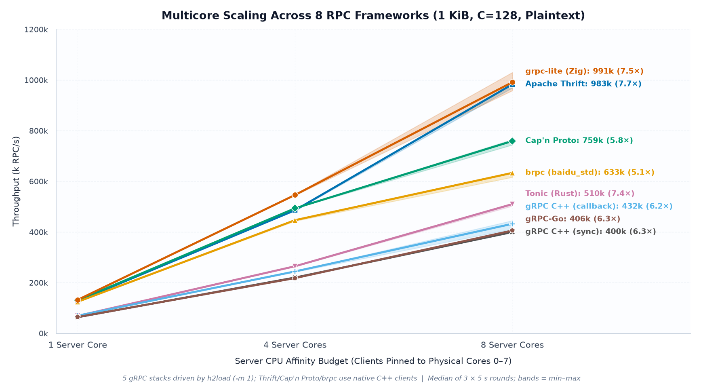
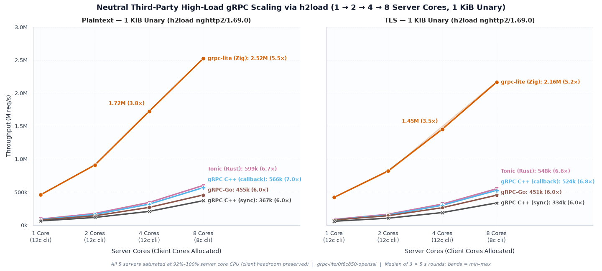
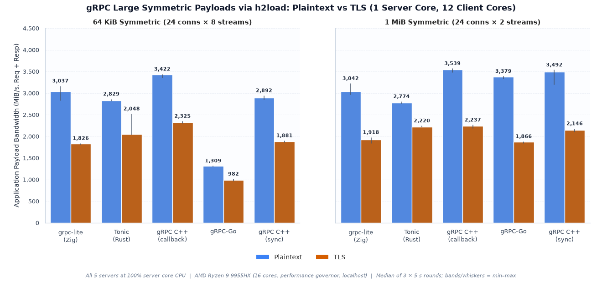
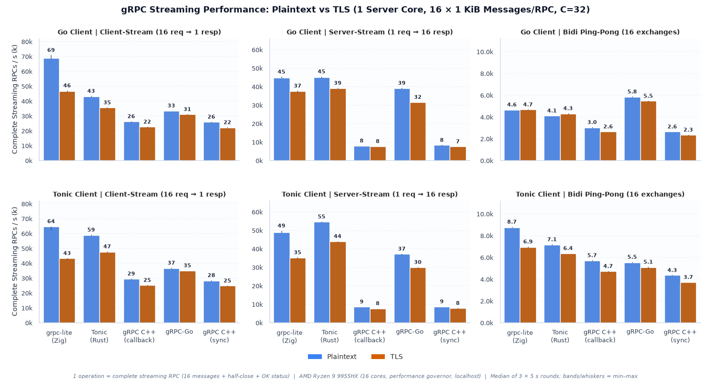

# RPC Framework Performance Report

> **Campaign:** [`2026-11-26-h2load-0f6c850`](../results/2026-11-26-h2load-0f6c850/README.md) &nbsp;|&nbsp; **Formal Runs:** 780 (+ 260 smoke) &nbsp;|&nbsp; **Client-reported completions:** 523,239,246 &nbsp;|&nbsp; **Companion Go Unary Validations:** 465 replays (246,487,488 RPCs, 0 errors)
>
> **Host:** AMD Ryzen 9 9955HX (16 physical cores / 32 threads, `performance` governor, Linux x86_64, localhost TCP)  
> **Primary gRPC Load Generator:** Off-the-shelf **`h2load` (`nghttp2/1.69.0`)** for all Unary scenarios (zero custom client bias, 92%–100% server saturation), paired with companion `bin/bench-client` gRPC unary validation replays; Go (`1.83.2`) & Tonic (`0.14.6`) clients for Streaming; native C++ clients for Thrift, Cap'n Proto, and brpc.  
> **Charts:** Generated via [Benchkit](https://github.com/open-s4c/benchkit) (`benchkit.lwchart`) in both PNG and vector PDF — see [`harness/plot_report.py`](../harness/plot_report.py) to regenerate.

---

## Executive Summary

This report evaluates **8 RPC server stacks** (`grpc-lite 0f6c850` with OpenSSL 4.0.3, `Tonic 0.14.6`, `gRPC C++ 1.84.3` callback & sync, `gRPC-Go 1.83.2`, `Apache Thrift 0.25.0`, `Cap'n Proto 1.5.0`, and `brpc 1.18.0`) using neutral third-party **`h2load` (`nghttp2/1.69.0`)** across all gRPC Unary matrices so fast servers are never capped by Go, Tonic, or blocking C++ client CPU ceilings:

1. **Part 1 — Cross-Protocol Plaintext Matrix (360 formal runs, 215.7M client-reported completions, 225 companion unary validations):** 8 frameworks compared under identical **1-connection-per-worker (`-m 1`)** closed-loop topology (`Thrift`, `Cap'n Proto`, `brpc` on native C++ clients; all 5 gRPC servers on `h2load -m 1`) across latency (`0 B / 64 B / 1 KiB`), concurrency (`C = 1 → 128`), multicore (`1 / 4 / 8` cores), large payloads (`1 KiB / 64 KiB / 1 MiB`), and asymmetric payloads (`64 B ↔ 64 KiB`).
2. **Part 2 — Multiplexed gRPC Plaintext vs. TLS Matrix via `h2load` (240 formal runs, 286.6M HTTP/2 completions, 240 companion unary validations):** All 5 gRPC servers driven to **92%–100% server core saturation** across `1 / 2 / 4 / 8` server cores (`12` client cores for `1–4c`, `8` client cores for `8c`, `-m 16`), large symmetric payloads (`64 KiB`, `1 MiB`), and asymmetric payloads (`64 B ↔ 64 KiB`) in both Plaintext (`h2c`) and TLS (`h2`).
3. **Part 3 — gRPC Streaming Matrix (180 formal runs, 20.9M checked RPCs):** All 5 gRPC servers tested across `client-stream`, `server-stream`, and `bidi` ping-pong (`16 × 1 KiB`/RPC, Plaintext & TLS) using Go (`1.83.2`) and Tonic (`0.14.6`) dual-process load generators (since `h2load` only supports HTTP/2 unary).

### Headline Findings

**Throughput units in all tables and figures:** For the five gRPC unary stacks, RPC/s is the `h2load` HTTP/2 completion rate (`completion_scope: "http2"`). Payload MiB/s is calculated from that rate and the configured payload sizes. Native and streaming clients count application-checked RPCs (`completion_scope: "rpc"`).

| Dimension | Winner in This Setup | Headline Metric (Median of 3 × 5 s Rounds) | Key Takeaway |
| --- | --- | --- | --- |
| **Lowest 1 KiB Latency (C=1, 1 core, `-m 1`)** | **Apache Thrift** / **grpc-lite** | **15.5 µs** / **16.0 µs** P50 (`19.9 / 21.0 µs` P99) | Removing blocking C++ gRPC client overhead (`~14 µs`) puts **`grpc-lite` within `0.5 µs` of raw framed binary Thrift** and ahead of Cap'n Proto (`17.5 µs`) and brpc (`20.7 µs`). |
| **Peak 8-Core Plaintext (`C=128`, `-m 1`)** | **grpc-lite (Zig)** | **991,232 RPC/s** (`7.49×`, **`201 µs`** P99) | Even without HTTP/2 multiplexing (`-m 1`), **`grpc-lite` leads all 8 frameworks (`958k–1.03M` across rounds)**, ahead of Apache Thrift (`983.0k`, `231 µs` P99), Cap'n Proto (`759.2k`), and brpc (`633.4k`). |
| **Multiplexed gRPC Multicore (`h2load`, 4c / 8c)** | **grpc-lite (Zig)** | **1.72M / 2.52M** PT · **1.45M / 2.16M** TLS | In the 8-core configuration, throughput is **4.2× / 3.95×** Tonic's (`599k / 548k`), with **`1.40–2.80 ms` P99** at a concurrency limit of 1,536 streams and `<1%` 3-round spread. |
| **Large Symmetric 64 KiB / 1 MiB (8 Frameworks, `-m 1`)** | **Apache Thrift** (64K) / **Cap'n Proto** (1M) | **5,276 MiB/s** (64 KiB) · **6,380 MiB/s** (1 MiB)* | Non-HTTP/2 binary protocols lead bulk plaintext bandwidth (`Cap'n Proto` hits `6,380 MiB/s` median at 1 MiB with `50.4%` bimodal spread; `Thrift` leads 64 KiB and holds steady at `4,424 MiB/s` @ 1 MiB); among gRPC stacks, `grpc-lite` leads 64 KiB (`2,954 MiB/s`) while `gRPC-Go` leads 1 MiB (`3,347 MiB/s`). |
| **Large Symmetric 64 KiB / 1 MiB gRPC (`h2load`, PT & TLS)** | **gRPC C++ (callback)** | **3,422 / 2,325 MiB/s** (64 KiB) · **3,539 / 2,237 MiB/s** (1 MiB) | `C++ callback` leads throughput on both 64 KiB and 1 MiB in PT & TLS; `Tonic` takes #2 in TLS (`2,048 / 2,220 MiB/s`), while `grpc-lite` delivers **4×–9× tighter P99** (`8.5–13.9 ms` @ 64 KiB, `34.0–52.1 ms` @ 1 MiB vs `67–346 ms` for C++/Go). |
| **Asymmetric 64 B ↔ 64 KiB gRPC (`h2load`, PT & TLS)** | **grpc-lite** (Resp PT) / **Tonic** (Req) | **48.2k** PT (`64B→64K`) · **57.5k / 38.8k** (`64K→64B`) | `grpc-lite` leads large-response PT (`48.2k`, `4.2 ms` P99) and trails `C++ callback` slightly in TLS (`28.3k` vs `30.2k` at 8.5× tighter P99); **`Tonic` dominates large-request ingestion** in both PT (`57.5k`) and TLS (`38.8k`). |
| **gRPC Server-Streaming (1 core, 16×1 KiB)** | **Tonic (Rust)** | **44.9k / 54.5k** PT · **39.1k / 43.8k** TLS | Leads all 4 client/transport cells ahead of `grpc-lite` (`44.7k / 48.9k` PT, `37.3k / 35.1k` TLS) and `gRPC-Go` (`39.0k / 37.1k` PT, `31.5k / 29.8k` TLS). |
| **gRPC Client-Streaming & Bidi (1 core, 16×1 KiB)** | **grpc-lite** / **Tonic** / **gRPC-Go** | **68.6k** client-stream · **8.73k** bidi (Tonic cli) | `grpc-lite` leads Go-client client-stream (`68.6k / 46.4k`) and Tonic-client bidi (`8.73k / 6.91k`); `Tonic` leads Tonic-client TLS client-stream (`47.5k`); `gRPC-Go` leads Go-client bidi (`5.84k / 5.45k`). |

> **Why switching gRPC Unary to neutral `h2load` mattered:** In earlier runs using the blocking C++ `grpc-native` client and Go/Tonic load generators, client-side overhead added ~`14 µs` of RTT and saturated all 8 client cores (`778%–784% / 800%`), artificially capping 4–8 core `grpc-lite` at `425k–606k` (and clipping `Tonic` at `428k`). The same third-party `h2load` client achieved higher throughput without using `grpc-lite`'s own client.

---

## Testbed & Methodology

### Hardware, Isolation & Validation

- **CPU:** AMD Ryzen 9 9955HX — 16 physical cores / 32 threads, `performance` scaling governor verified on CPUs `0–15`.
- **Core pinning:**
  - **Part 1 (Native + `h2load -m 1`):** Clients pinned to physical cores `0–7`; servers pinned to `15` (1c), `12–15` (4c), or `8–15` (8c).
  - **Part 2 (Multiplexed `h2load`):** `1 / 2 / 4` server cores (`15`, `14–15`, `12–15`) paired with **12 client cores (`0–11`)**; `8` server cores (`8–15`) paired with **8 client cores (`0–7`)**.
  - **Part 3 (Streaming):** Two load-generator processes on `0–3` and `4–7`; server pinned to `15`.
- **Validation in this dataset:** Each `h2load` run performs a `curl` preflight check (HTTP/2 `200`, `grpc-status: 0`, response length), records zero HTTP/2 failures/errors/timeouts during timing (`completion_scope: "http2"`), and then runs a companion **`bin/bench-client` (Go `1.83.2`)** validation replay under matching CPU placement, connections, streams per connection, payload sizes, TLS mode, warmup, and duration. All **465 formal companion replays** (`225` in `native-measured/**/validation.json` + `240` in `h2load-measured/logs/*.validation.json`) verified **246,487,488 unary RPCs** with **0 errors** (requiring one unary response of the exact configured payload length and final gRPC `OK` on every call). Because the replay is a separate pass whose achieved rate can differ from `h2load`'s, only the replay's own calls are verified at the gRPC layer while timed `h2load` throughput remains explicitly reported as HTTP/2 completions. Native C++ and Go/Tonic streaming clients verify every RPC inline during timing (`completion_scope: "rpc"`).
- **Measurement protocol:** Every formal configuration runs **3 repetitions × 5 seconds** after warmup (`1 s` Part 1, `2 s` Parts 2 & 3). All tables report **round medians**; every Benchkit chart displays the **full observed min–max range**. Median three-round spread is **0.99%** (Part 1), **1.32%** (Part 2), and **0.85%** (Part 3).

### Tested Software Versions

| Stack | Protocol / API | Version / Commit | Runtime / Build Notes |
| --- | --- | --- | --- |
| **`h2load` (Unary Client)** | HTTP/2 + gRPC wire | `nghttp2/1.69.0` | System Fedora 45 package, OpenSSL 4.0.3 |
| **Apache Thrift** | Binary / Framed | `0.25.0` | C++17 Release, nonblocking I/O threads |
| **Cap'n Proto** | Two-party RPC | `1.5.0` | C++17 Release, pre-bound `SO_REUSEPORT` (`TCP_NODELAY`) |
| **brpc** | `baidu_std` | `1.18.0` | C++17 Release, system protobuf + OpenSSL 4 patch |
| **grpc-lite** | gRPC / HTTP/2 | `0f6c850` (Zig 0.17.0) | `ReleaseFast`, `-Dtls=true` (OpenSSL 4.0.3) + interop patch |
| **Tonic** | gRPC / HTTP/2 | `0.14.6` (Rust 1.100.0) | Tokio `1.53.1`, `tls-ring`, Release (`--locked`) |
| **gRPC C++ (callback / sync)** | gRPC / HTTP/2 | `1.84.3` (GCC 16.2.1) | CMake Release, bundled protobuf & Abseil, `SERVER_THREADS` tuned |
| **gRPC-Go** | gRPC / HTTP/2 | `1.83.2` (Go 1.26.2) | Frozen campaign binary (`bin/bench-client` also runs companion unary validation); matching `GOMAXPROCS` |

---

## Part 1 — Cross-Protocol Plaintext Comparison (8 Frameworks, `-m 1`)

All 8 frameworks run under an identical **1-connection-per-worker closed-loop topology** ([`harness/campaign_native.py`](../harness/campaign_native.py), managed by Benchkit): `Apache Thrift`, `Cap'n Proto`, and `brpc` use their native C++ clients (`1` thread / `1` socket per worker), while all 5 gRPC servers use neutral **`h2load` (`nghttp2/1.69.0`) with strict `-m 1`** (`1` in-flight RPC per TCP connection, `-t min(8, C) -c C -m 1`).

In the tables below, RPC/s means HTTP/2 completions/s for `h2load` rows and checked RPCs/s for native rows.

### 1.1 Single-Request Latency (`C = 1`, 1 Server Core)


| Stack | 0 B P50 (µs) | 64 B P50 (µs) | 1 KiB P50 (µs) | 1 KiB P95 (µs) | 1 KiB P99 (µs) | 1 KiB RPC/s |
| --- | ---: | ---: | ---: | ---: | ---: | ---: |
| **Apache Thrift** | **14.8** | **15.0** | **15.5** | **18.4** | **19.9** | **63,636** |
| **grpc-lite (Zig)** | 16.0 | 16.0 | **16.0** | 19.0 | **21.0** | 55,950 |
| **Cap'n Proto** | 17.0 | 17.2 | 17.5 | 20.6 | 22.8 | 56,156 |
| **brpc (`baidu_std`)** | 20.0 | 20.4 | 20.7 | 24.1 | 27.3 | 47,449 |
| **Tonic (Rust)** | 19.0 | 19.0 | 22.0 | 24.0 | 28.0 | 41,586 |
| **gRPC-Go (`1.83.2`)** | 21.0 | 22.0 | 22.0 | 26.0 | 44.0 | 40,847 |
| **gRPC C++ (callback)** | 23.0 | 23.0 | 24.0 | 31.0 | 36.0 | 37,697 |
| **gRPC C++ (sync)** | 26.0 | 26.0 | 27.0 | 30.0 | 33.0 | 34,804 |

**Observations:**
- **HTTP/2 + gRPC does NOT inherently cost 2× latency:** once blocking C++ gRPC client overhead is removed, **`grpc-lite` hits `16.0 µs` P50 / `21.0 µs` P99** — within `0.5 µs` of `Apache Thrift` (`15.5 / 19.9 µs`) and ahead of `Cap'n Proto` (`17.5 / 22.8 µs`) and `brpc` (`20.7 / 27.3 µs`).
- Every gRPC server drops by `~14–16 µs` vs. the legacy sync `grpc-native` client: `Tonic` and `gRPC-Go` both achieve `22.0 µs` P50 (with `Tonic` holding a much tighter `28.0 µs` P99 vs `44.0 µs` for Go), while `gRPC C++ callback` (`24.0 µs`) edges out `sync` (`27.0 µs`).

---

### 1.2 Single-Core Concurrency Scaling (`C = 1 → 128`, 1 KiB)


| Stack | C=1 (k RPC/s) | C=8 (k RPC/s) | C=32 (k RPC/s) | C=128 (k RPC/s) | C=128 P50 (µs) | C=128 P99 (µs) |
| --- | ---: | ---: | ---: | ---: | ---: | ---: |
| **grpc-lite (Zig)** | 55.6 | 129.3 | **134.6** | **131.9** | 963 | 1,130 |
| **Cap'n Proto** | 56.1 | **135.5** | 131.8 | 129.5 | 987 | 1,069 |
| **Apache Thrift** | **64.2** | 128.1 | 126.5 | 127.1 | 1,004 | 1,081 |
| **brpc (`baidu_std`)** | 47.4 | 123.4 | 126.5 | 125.4 | **950** | **1,016** |
| **gRPC C++ (callback)** | 37.6 | 65.5 | 70.1 | 69.2 | 1,710 | **6,210** |
| **Tonic (Rust)** | 41.1 | 70.2 | 69.4 | 68.9 | 1,880 | 1,930 |
| **gRPC-Go (`1.83.2`)** | 40.7 | 70.1 | 66.6 | 64.2 | 1,970 | 3,520 |
| **gRPC C++ (sync)** | 34.7 | 51.5 | 60.5 | 63.7 | 1,950 | 3,700 |

**Observations:**
- **Two sharp single-core tiers:** `grpc-lite`, `Cap'n Proto`, `Thrift`, and `brpc` all saturate near **125k–135k RPC/s** with razor-tight **1.02–1.13 ms P99** at `C=128` (`grpc-lite` is the sole gRPC stack in this upper tier, ~2× faster than Tonic/C++/Go).
- In Tier 2, `gRPC C++ (callback)` (`69.2k`) and `Tonic` (`68.9k`) tie at `C=128`, with `Tonic` retaining dramatically cleaner tail latency (`1.93 ms` P99, practically equal to its `1.88 ms` P50, vs `6.21 ms` for `C++ callback`).

---

### 1.3 Multicore Scaling (`1 → 4 → 8` Server Cores, 1 KiB, `C = 128`, `-m 1`)



| Stack | 1 Core (RPC/s) | 4 Cores (RPC/s) | 8 Cores (RPC/s) | 8c / 1c Scaling | 8c P99 (µs) | 8c Client / Server CPU % |
| --- | ---: | ---: | ---: | ---: | ---: | ---: |
| **grpc-lite (Zig)** | **132,327** | **546,302** | **991,232** | 7.49× | **201** | 486% / 518% |
| **Apache Thrift** | 127,456 | 486,027 | 982,999 | **7.71×** | 231 | 435% / 510% |
| **Cap'n Proto** | 129,809 | 493,580 | 759,179 | 5.85× | 993 | 561% / 356% |
| **brpc (`baidu_std`)** | 124,517 | 446,706 | 633,357 | 5.09× | 258 | 556% / 408% |
| **Tonic (Rust)** | 68,969 | 264,803 | 510,026 | 7.40× | 466 | 360% / 513% |
| **gRPC C++ (callback)** | 69,630 | 244,321 | 432,215 | 6.21× | 1,270 | 260% / 552% |
| **gRPC-Go (`1.83.2`)** | 64,266 | 217,992 | 405,848 | 6.32× | 1,270 | 231% / 609% |
| **gRPC C++ (sync)** | 63,578 | 220,090 | 399,737 | 6.29× | 731 | 226% / 561% |

**Observations:**
- **`grpc-lite` takes #1 overall across all 8 RPC frameworks** under `-m 1`: scaling **`7.49×`** to **`991,232 RPC/s`** (`958k–1.03M` across rounds) at **`201 µs` P99**, edging ahead of **Apache Thrift** (`983.0k`, `7.71×`, `231 µs`), **Cap'n Proto** (`759.2k`), and **brpc** (`633.4k`) — even with HTTP/2 multiplexing disabled (`-m 1`).
- Among the remaining gRPC stacks on 8 cores, `Tonic` leads at `510.0k` (`7.40×`, `466 µs` P99), followed by `gRPC C++ callback` (`432.2k`), `gRPC-Go` (`405.8k`), and `gRPC C++ sync` (`399.7k`, `731 µs` P99).

---

### 1.4 Large Symmetric & Asymmetric Payloads (1 Server Core, `C = 32`, `-m 1`)


| Stack | 64 KiB RPC/s | 64 KiB MiB/s | 1 MiB RPC/s | 1 MiB MiB/s | 1 MiB P99 (ms) |
| --- | ---: | ---: | ---: | ---: | ---: |
| **Cap'n Proto** | 34,598 | 4,325 | **3,190*** | **6,380*** | **11.7** |
| **Apache Thrift** | **42,208** | **5,276** | 2,212 | 4,424 | 15.4 |
| **brpc (`baidu_std`)** | 35,663 | 4,458 | 1,946 | 3,892 | 49.7 |
| **gRPC-Go (`1.83.2`)** | 12,248 | 1,531 | 1,674 | 3,347 | 86.2 |
| **gRPC C++ (sync)** | 19,864 | 2,483 | 1,532 | 3,065 | 110.2 |
| **gRPC C++ (callback)** | 21,985 | 2,748 | 1,505 | 3,011 | 123.9 |
| **Tonic (Rust)** | 20,300 | 2,538 | 1,434 | 2,868 | 34.5 |
| **grpc-lite (Zig)** | 23,635 | 2,954 | 1,389 | 2,778 | 24.1 |

*\*Note: `Cap'n Proto` 1 MiB exhibited a bimodal 3-round spread (`50.4%`: `1,765 / 3,372 / 3,190 RPC/s`, i.e., `3,531–6,744 MiB/s`), reflected in the whisker bounds of Figure 5.*


| Stack | 64 B Req → 64 KiB Resp (RPC/s) | 64 KiB Req → 64 B Resp (RPC/s) | Direction Ratio (Large-Req / Large-Resp) |
| --- | ---: | ---: | ---: |
| **Apache Thrift** | 52,923 | **77,413** | 1.46× |
| **brpc (`baidu_std`)** | 51,246 | 66,884 | 1.31× |
| **Cap'n Proto** | **55,426** | 53,349 | 0.96× |
| **grpc-lite (Zig)** | 36,847 | 40,908 | 1.11× |
| **Tonic (Rust)** | 26,090 | 45,908 | **1.76×** |
| **gRPC C++ (callback)** | 36,517 | 32,663 | 0.89× |
| **gRPC C++ (sync)** | 36,196 | 34,541 | 0.95× |
| **gRPC-Go (`1.83.2`)** | 18,882 | 21,799 | 1.15× |

**Observations:**
- **At 64 KiB and 1 MiB, framing overhead shrinks and memory-copy / HTTP/2 flow-control mechanics dominate:** `Apache Thrift` leads 64 KiB (`5,276 MiB/s`) and delivers consistent 1 MiB bandwidth (`4,424 MiB/s`, `15.4 ms` P99), while `Cap'n Proto` posts the highest 1 MiB median (`6,380 MiB/s`, `11.7 ms` P99) across a bimodal 3-round range (`3,531–6,744 MiB/s`).
- Among the 5 gRPC stacks at `-m 1`: `grpc-lite` leads 64 KiB (`2,954 MiB/s`) and maintains the tightest 1 MiB P99 (`24.1 ms` vs `86.2–123.9 ms` for Go/C++), whereas `gRPC-Go` (`3,347 MiB/s`) and `gRPC C++` (`3,011–3,065 MiB/s`) achieve higher 1 MiB throughput at the cost of 3.6×–5.1× worse tail latency.

---

## Part 2 — Multiplexed gRPC Plaintext vs. TLS Matrix via `h2load`

This 240-run matrix ([`harness/campaign_h2load.py`](../harness/campaign_h2load.py)) tests all **5 gRPC server configurations** under **HTTP/2 multiplexing** using **`h2load` (`nghttp2/1.69.0`)** in both Plaintext (`h2c`) and TLS (`h2`, OpenSSL), with every run followed by a companion `bin/bench-client` gRPC validation replay (`240` files, `167.2M` verified unary RPCs, `0` errors). Across **286.6M HTTP/2 completions**, every server reached **92%–100% server core utilization** while `h2load` preserved client CPU headroom. All throughput columns below give HTTP/2 completions per second.

### 2.1 Multicore 1 KiB Unary Scaling: Plaintext & TLS (`1 → 2 → 4 → 8` Server Cores)



All five servers share the same client settings within each column. The 1- and 2-core configurations use 48 connections; the 4- and 8-core configurations use 96. At 16 concurrent streams per connection, the load limit doubles from 768 to 1,536 streams. From 4 to 8 server cores, connections stay fixed but `h2load` drops from 12 threads on 12 client cores to 8 threads on 8 cores. The `4c / 1c` and `8c / 1c` columns compare end-to-end configurations rather than isolating the effect of server core count.

#### Plaintext (`h2c`, 1 KiB Unary)

| Server | 1c (12c cli) | 2c (12c cli) | 4c (12c cli) | 8c (8c cli) | 4c / 1c | 8c / 1c | 8c P50 / P99 (ms) | 8c Srv / Cli Core CPU % |
| --- | ---: | ---: | ---: | ---: | ---: | ---: | ---: | ---: |
| **grpc-lite (Zig)** | **457,790** | **909,740** | **1,722,504** | **2,524,270** | 3.76× | 5.51× | **0.46 / 2.80** | 742% / 637% |
| **Tonic (Rust)** | 89,306 | 174,028 | 340,764 | 598,964 | 3.82× | 6.71× | 2.33 / 7.19 | 783% / 354% |
| **gRPC C++ (callback)** | 80,811 | 159,514 | 315,043 | 566,000 | **3.90×** | **7.00×** | 0.37 / 30.87 | 794% / 346% |
| **gRPC-Go (`1.83.2`)** | 75,533 | 138,838 | 265,748 | 454,913 | 3.52× | 6.02× | 2.78 / 15.70 | 754% / 277% |
| **gRPC C++ (sync)** | 60,879 | 113,843 | 205,174 | 367,399 | 3.37× | 6.03× | 3.75 / 14.38 | 789% / 128% |

#### TLS (`h2`, OpenSSL, 1 KiB Unary)

| Server | 1c (12c cli) | 2c (12c cli) | 4c (12c cli) | 8c (8c cli) | 4c / 1c | 8c / 1c | 8c P50 / P99 (ms) | 8c Srv / Cli Core CPU % |
| --- | ---: | ---: | ---: | ---: | ---: | ---: | ---: | ---: |
| **grpc-lite (Zig, OpenSSL)** | **417,440** | **819,498** | **1,452,191** | **2,164,667** | 3.48× | 5.19× | **0.61 / 1.40** | 784% / 613% |
| **Tonic (Rust, ring)** | 83,652 | 162,526 | 316,648 | 548,111 | 3.79× | 6.55× | 2.54 / 7.80 | 781% / 384% |
| **gRPC C++ (callback)** | 76,934 | 150,063 | 299,027 | 524,017 | **3.89×** | **6.81×** | 0.41 / 34.94 | 793% / 384% |
| **gRPC-Go (`1.83.2`)** | 75,648 | 140,092 | 261,586 | 451,072 | 3.46× | 5.96× | 3.00 / 14.56 | 764% / 322% |
| **gRPC C++ (sync)** | 55,849 | 102,144 | 187,613 | 333,566 | 3.36× | 5.97× | 4.11 / 16.92 | 788% / 134% |

**Observations:**
- **Within the 8-core configuration:** `grpc-lite` reaches **2.52M plaintext / 2.16M TLS RPC/s** (`0.40% / 0.95%` three-round spread), **4.2× / 3.95×** Tonic's throughput (`599k / 548k`).
- **From 4 to 8 server cores:** Throughput increases for all five servers (`1.47×–1.80×`). The 1 s smoke runs also produced higher 8-core throughput than the 5 s formal runs across all five servers. Neither comparison establishes how much temperature, clock frequency, or the smaller client allocation contributed to the sublinear gain.
- **Tonic vs. gRPC C++ callback:** `Tonic` edges ahead of `gRPC C++ (callback)` by **+5.8%** PT (`599k` vs `566k`) and **+4.6%** TLS (`548k` vs `524k`) on 8 cores while delivering **4.3×–4.5× tighter P99** (`7.19–7.80 ms` vs `30.9–34.9 ms`). `gRPC-Go 1.83.2` shows virtually zero TLS overhead (`455k` PT vs `451k` TLS on 8 cores).

---

### 2.2 Large Symmetric Payloads (`64 KiB` & `1 MiB`, 1 Core, Plaintext vs. TLS)



| Server | 64 KiB PT (RPC/s · MiB/s) | 64 KiB TLS (RPC/s · MiB/s) | 64 KiB P99 PT/TLS (ms) | 1 MiB PT (RPC/s · MiB/s) | 1 MiB TLS (RPC/s · MiB/s) | 1 MiB P99 PT/TLS (ms) |
| --- | ---: | ---: | ---: | ---: | ---: | ---: |
| **gRPC C++ (callback)** | **27,376 · 3,422** | **18,601 · 2,325** | 74.8 / 97.0 | **1,769 · 3,539** | **1,118 · 2,237** | 163.7 / 199.6 |
| **gRPC C++ (sync)** | 23,134 · 2,892 | 15,048 · 1,881 | 47.0 / 67.1 | 1,746 · 3,492 | 1,073 · 2,146 | 144.2 / 206.2 |
| **grpc-lite (Zig)** | 24,295 · 3,037 | 14,609 · 1,826 | **8.5 / 13.9** | 1,521 · 3,042 | 959 · 1,918 | **34.0 / 52.1** |
| **Tonic (Rust)** | 22,634 · 2,829 | 16,382 · 2,048 | 11.4 / 16.0 | 1,387 · 2,774 | 1,110 · 2,220 | 132.1 / 138.8 |
| **gRPC-Go (`1.83.2`)** | 10,474 · 1,309 | 7,855 · 982 | 97.5 / 102.1 | 1,690 · 3,379 | 933 · 1,866 | 231.5 / 345.8 |

**Observations:**
- **`gRPC C++ (callback)` leads large-payload gRPC bandwidth** across all 4 cells (`3,422 / 2,325 MiB/s` at 64 KiB; `3,539 / 2,237 MiB/s` at 1 MiB), with `Tonic` taking #2 under TLS (`2,048 / 2,220 MiB/s`, virtually tying `C++ callback` at 1 MiB TLS).
- **`grpc-lite` trades ~11%–21% bulk bandwidth for dramatically cleaner tail latency:** `8.5 / 13.9 ms` P99 at 64 KiB and `34.0 / 52.1 ms` P99 at 1 MiB — **4.0×–8.8× tighter than `gRPC C++` and `gRPC-Go`** (`47–346 ms`).

---

### 2.3 Asymmetric Payloads (`64 B ↔ 64 KiB`, 1 Core, Plaintext vs. TLS)


| Server | 64 B → 64 KiB PT (RPC/s · P99 ms) | 64 B → 64 KiB TLS (RPC/s · P99 ms) | 64 KiB → 64 B PT (RPC/s · P99 ms) | 64 KiB → 64 B TLS (RPC/s · P99 ms) |
| --- | ---: | ---: | ---: | ---: |
| **grpc-lite (Zig)** | **48,162** · **4.2** | 28,282 · **7.1** | 47,895 · **4.3** | 26,755 · 7.5 |
| **Tonic (Rust)** | 28,328 · 9.3 | 22,110 · 12.0 | **57,534** · 4.5 | **38,815** · **6.6** |
| **gRPC C++ (callback)** | 41,127 · 37.1 | **30,186** · 60.4 | 41,064 · 47.7 | 30,805 · 66.5 |
| **gRPC C++ (sync)** | 38,965 · 17.6 | 27,103 · 43.5 | 37,292 · 10.8 | 24,134 · 30.7 |
| **gRPC-Go (`1.83.2`)** | 14,847 · 21.4 | 11,468 · 25.4 | 28,826 · 10.8 | 21,807 · 14.1 |

**Observations:**
- **Direction creates a crisp split between `grpc-lite` and `Tonic`:** `grpc-lite` is symmetric and leads **large-response Plaintext (`48.2k`, `4.2 ms` P99)** while running close to `C++ callback` on TLS (`28.3k` vs `30.2k` at **8.5× lower P99**). Conversely, **`Tonic` dominates large-request ingestion (`64 KiB → 64 B`)** in both Plaintext (`57.5k`, `3,599 MiB/s`) and TLS (`38.8k`, `2,428 MiB/s`, `6.6 ms` P99).

---

## Part 3 — gRPC Streaming Matrix (Go & Tonic Clients, 1 Core, `16 × 1 KiB`)

Because `h2load` is an HTTP/2 Unary tool and cannot perform multi-frame gRPC streaming, the 3 streaming modes run with dual-process **Go (`1.83.2`)** and **Tonic (`0.14.6`)** gRPC clients ([`harness/campaign_extended.py --streaming-only`](../harness/campaign_extended.py), 180 formal runs, 20.9M checked streaming RPCs, 0 errors). Each operation is one complete streaming RPC (16 messages or 16 ping-pong exchanges + half-close + `OK`).



| Mode | Server | Plaintext (Go / Tonic RPC/s) | TLS (Go / Tonic RPC/s) |
| --- | --- | ---: | ---: |
| **Client-Stream** | **grpc-lite (Zig)** | **68,629** / **64,402** | **46,413** / 43,120 |
| **Client-Stream** | **Tonic (Rust)** | 43,046 / 58,842 | 35,375 / **47,489** |
| **Client-Stream** | **gRPC-Go (`1.83.2`)** | 33,312 / 36,600 | 30,950 / 34,946 |
| **Client-Stream** | **gRPC C++ (callback)** | 26,033 / 29,294 | 22,462 / 25,154 |
| **Client-Stream** | **gRPC C++ (sync)** | 25,739 / 28,179 | 22,116 / 24,708 |
| **Server-Stream** | **Tonic (Rust)** | **44,856** / **54,514** | **39,069** / **43,817** |
| **Server-Stream** | **grpc-lite (Zig)** | 44,741 / 48,887 | 37,337 / 35,085 |
| **Server-Stream** | **gRPC-Go (`1.83.2`)** | 38,958 / 37,084 | 31,514 / 29,802 |
| **Server-Stream** | **gRPC C++ (sync)** | 8,218 / 8,639 | 7,474 / 7,770 |
| **Server-Stream** | **gRPC C++ (callback)** | 7,911 / 8,527 | 7,581 / 7,651 |
| **Bidi Ping-Pong** | **grpc-lite (Zig)** | 4,645 / **8,731** | 4,655 / **6,910** |
| **Bidi Ping-Pong** | **gRPC-Go (`1.83.2`)** | **5,842** / 5,530 | **5,451** / 5,079 |
| **Bidi Ping-Pong** | **Tonic (Rust)** | 4,083 / 7,148 | 4,294 / 6,358 |
| **Bidi Ping-Pong** | **gRPC C++ (callback)** | 3,020 / 5,693 | 2,631 / 4,698 |
| **Bidi Ping-Pong** | **gRPC C++ (sync)** | 2,628 / 4,344 | 2,338 / 3,697 |

**Observations:**
- **Tonic leads Server-Streaming across all 4 cells (`44.9k / 54.5k` PT, `39.1k / 43.8k` TLS)** via zero-spawn `tokio_stream::iter(...)`, followed closely by `grpc-lite` (`44.7k / 48.9k` PT, `37.3k / 35.1k` TLS) and `gRPC-Go` (`39.0k / 37.1k` PT, `31.5k / 29.8k` TLS).
- **gRPC C++ (`sync` & `callback`) remains at ~`7.5k–8.6k` on Server-Streaming:** standard per-message `Write()` / single-in-flight `StartWrite()` flushes each of the 16 responses individually (and enabling `WriteOptions::set_buffer_hint()` deadlocks on synchronous/single-in-flight corking).
- **Client-Stream & Bidi show client-server affinity:** `grpc-lite` leads Go-client client-stream (`68.6k / 46.4k`) and Tonic-client bidi (`8.73k / 6.91k`), `Tonic` leads Tonic-client TLS client-stream (`47.5k`), and `gRPC-Go` leads Go-client bidi (`5.84k / 5.45k`).

---

## Practical Framework Selection Guide

| Use Case | Strongest Candidates | Rationale from Measured Data |
| --- | --- | --- |
| **Peak gRPC throughput, lowest gRPC latency & tightest P99 (PT & TLS)** | **grpc-lite (Zig)** | Matches Thrift within `0.5 µs` on 1 KiB P50 (`16.0 µs`), hits **#1 overall at 8 cores (`991k` `-m 1`; `2.52M` PT / `2.16M` TLS multiplexed)** with `1.40–2.80 ms` P99, and leads client-stream + Tonic-client bidi. |
| **Non-gRPC ultra-low latency & bulk binary bandwidth** | **Apache Thrift**, **Cap'n Proto**, **brpc** | `Thrift` leads 1 KiB P50 (`15.5 µs`) and 64 KiB plaintext bandwidth (`5,276 MiB/s`) with steady 1 MiB throughput (`4,424 MiB/s`, `15.4 ms` P99); `Cap'n Proto` posts the highest 1 MiB median (`6,380 MiB/s`, bimodal spread) and leads `64 B → 64 KiB` (`55.4k`). |
| **All-around production Rust gRPC (multicore, streaming, large uploads)** | **Tonic (Rust)** | #2 gRPC on 8 cores (`599k` PT / `548k` TLS, tight `7.2–7.8 ms` P99), **#1 in server-streaming** (`54.5k` PT / `43.8k` TLS), **#1 in large-request ingestion** (`57.5k` PT / `38.8k` TLS), and #2 in large-payload TLS (`2.05–2.22 GiB/s`). |
| **Maximum gRPC bulk payload bandwidth (64 KiB / 1 MiB)** | **gRPC C++ (callback)** | Leads multiplexed gRPC 64 KiB (`3,422 / 2,325 MiB/s`) and 1 MiB (`3,539 / 2,237 MiB/s`) in both PT & TLS, and hits `566k / 524k` in the 8-core configuration. *Caveat: monitor bimodal P99 (`31–35 ms` @ 1 KiB 8c, `164–200 ms` @ 1 MiB) and ~8k server-streaming.* |
| **Go ecosystem gRPC with zero TLS penalty** | **gRPC-Go (`1.83.2`)** | Essentially 100% TLS retention on 1–8 cores (`455k` PT vs `451k` TLS @ 8c), strong server-streaming (`39k / 32k`) and Go-client bidi (`5.84k / 5.45k`). *Caveat: slower at 64 KiB (`10.5k / 7.9k`).* |

---

## Variability, Limits & Reproducibility

### Known Variability & Methodological Limits
- **Run-to-run spread:** Median `(max - min) / median` spread across 3 formal rounds is **0.99%** (Part 1), **1.32%** (Part 2), and **0.85%** (Part 3). Largest spreads occur in `Cap'n Proto` 1 MiB (`50.4%`, `1,765 / 3,372 / 3,190 RPC/s`), `gRPC C++ callback` `64 B → 64 KiB` TLS (`26.2%`), `Tonic` 64 KiB TLS (`23.3%`), and `brpc` 1 MiB (`12.4%`). Notably, `grpc-lite` 8-core multiplexed runs were tightly repeatable (`0.40%` PT, `0.95%` TLS). All charts show exact observed min–max whiskers/bands.
- **Closed-loop measurement:** Does not correct for coordinated omission. Localhost TCP excludes physical NIC latency, packet loss, switch queueing, and NUMA/cross-host effects.
- **Cross-matrix boundaries:** Do not mix raw throughput across Part 1 (`-m 1`), Part 2 (multiplexed `h2load`), and Part 3 (Go/Tonic streaming).
- **Clean dataset repository:** Earlier pre-fix datasets, client-limited baselines, and pre-validation archives have been removed from the working tree; [`results/2026-11-26-h2load-0f6c850/`](../results/2026-11-26-h2load-0f6c850/README.md) is the sole authoritative dataset in the repository.

### Reproducing the Benchkit Graphs

All 10 figures (PNG + vector PDF) in [`report/figures/`](figures/) are deterministically generated from the raw campaign data using Benchkit's `lwchart` engine:

```sh
/path/to/benchkit-venv/bin/python harness/plot_report.py \
  --dataset results/2026-11-26-h2load-0f6c850 \
  --output report/figures
```
