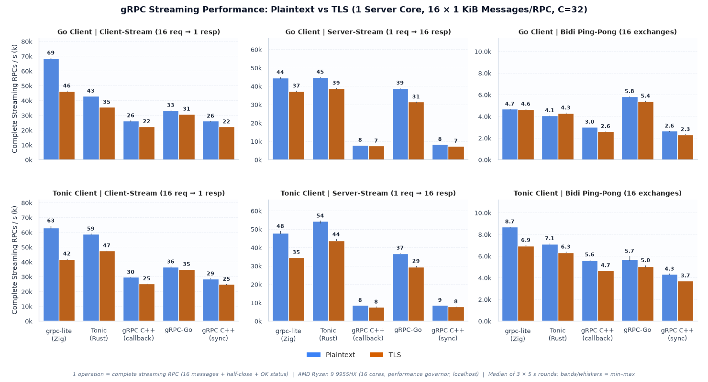
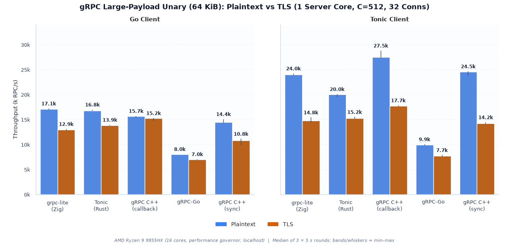

# RPC Framework Performance Report

> **Campaign:** [`2026-11-25-full-0f6c850`](../results/2026-11-25-full-0f6c850/README.md) &nbsp;|&nbsp; **Formal Runs:** 780 (+ 260 smoke) &nbsp;|&nbsp; **Completed RPCs:** 474,043,546 &nbsp;|&nbsp; **Errors:** 0
>
> **Host:** AMD Ryzen 9 9955HX (16 physical cores / 32 threads, `performance` governor, Linux x86_64, localhost TCP)  
> **Charts:** Generated via [Benchkit](https://github.com/open-s4c/benchkit) (`benchkit.lwchart`) in both PNG and vector PDF — see [`harness/plot_report.py`](../harness/plot_report.py) to regenerate.

---

## Executive Summary

This report evaluates **8 RPC server stacks** on the post-fix benchmark suite with **`grpc-lite` updated to `0f6c850`** (OpenSSL 4.0.3) and **`gRPC-Go` on `1.83.2`**, across two independent, zero-error benchmark matrices on the same machine:

1. **Native Cross-Protocol Matrix (360 formal runs, 192.7M RPCs):** Plaintext closed-loop C++ clients comparing **Apache Thrift**, **Cap'n Proto**, **brpc (`baidu_std`)**, **grpc-lite (`0f6c850`)**, **Tonic**, **gRPC C++ (callback)**, **gRPC C++ (sync)**, and **gRPC-Go** across latency, concurrency, multicore scaling, large payloads, and asymmetric payloads.
2. **Extended gRPC Matrix (420 formal runs, 281.4M RPCs):** Five gRPC server configurations tested with both **gRPC-Go (`1.83.2`)** and **Tonic (`0.14.6`)** multi-process load generators across **Plaintext vs. certificate-verified TLS**, **1 / 4 / 8 server cores**, **1 KiB vs. 64 KiB**, and **all 4 RPC modes** (unary, client-stream, server-stream, bidi ping-pong).

### Headline Findings

| Dimension | Winner in This Setup | Headline Metric (Median of 3 × 5 s Rounds) | Key Takeaway |
| --- | --- | --- | --- |
| **Lowest 1 KiB Latency (C=1, 1 core)** | **Apache Thrift** | **15.5 µs** P50 / **21.6 µs** P99 | Non-HTTP/2 binary protocols (`Thrift`, `Cap'n Proto`, `brpc`) run at roughly half the latency of gRPC stacks. |
| **Fastest gRPC Latency (C=1, 1 core)** | **grpc-lite (Zig)** | **29.8 µs** P50 / **40.3 µs** P99 | Leads all gRPC stacks by 17%–27% on median RTT. |
| **Peak 8-Core Plaintext Throughput (Native)** | **Apache Thrift** | **984.2k RPC/s** (7.68× scaling) | Followed by `Cap'n Proto` (765k) and `brpc` (637k). `grpc-lite` leads gRPC (425k) before hitting a C++ client CPU ceiling. |
| **1-Core gRPC Unary (Plaintext / TLS)** | **grpc-lite (Zig)** | **434.9k / 345.8k RPC/s** (Go client) | **4.7×** Tonic in plaintext and **4.1×** Tonic over TLS with OpenSSL 4.0.3 (`407.4k / 271.7k` with Tonic client). |
| **Large Symmetric 1 MiB Payload (1 core)** | **Cap'n Proto** | **7,166 MiB/s** (`3,583` RPC/s, `11.1 ms` P99) | `Cap'n Proto` leads all stacks by +62%; `Tonic` leads gRPC at **4,214 MiB/s** (`21.9 ms` P99); `grpc-lite 0f6c850` rose +17% to `3,022 MiB/s` (`25.7 ms` P99). |
| **gRPC Server-Streaming (1 core, 16×1 KiB)** | **Tonic (Rust)** | **44.8k / 54.2k** PT · **38.7k / 43.6k** TLS | After removing the artificial `mpsc::channel(1)` + `tokio::spawn` bug, **Tonic jumps ~6× to #1 overall**, edging past `grpc-lite` (`44.4k / 47.7k` PT, `37.3k / 34.6k` TLS). |
| **gRPC Client-Streaming & Bidi (1 core)** | **grpc-lite (Zig)** / **Tonic** / **gRPC-Go** | **68.6k** client-stream · **8.7k** bidi (Tonic client) | `grpc-lite` leads Go-client client-stream (`68.6k / 46.3k`) and Tonic-client bidi (`8.68k / 6.94k`); `Tonic` leads Tonic-client TLS client-stream (`47.5k`); `gRPC-Go` leads Go-client bidi (`5.80k / 5.39k`). |
| **gRPC C++ Sync vs. Callback API** | **Workload-dependent** | Native 8c: **sync +8.9%** (`374k` vs `344k`) · Extended 8c: **callback +21–36%** | Properly applying `SERVER_THREADS` lifted C++ sync +28% on native 8 cores (`801 µs` P99 vs `1,364 µs` callback); C++ callback still dominates multiplexed extended unary (`429k` PT / `398k` TLS) and 64 KiB Tonic-client unary (`27.5k` / `17.7k`). |

> **Scope reminder:** The native and extended matrices use different client implementations and connection topologies. **Compare frameworks within each matrix**, not by mixing numbers across matrices. Closed-loop localhost runs measure end-to-end client+server stacks, not universal isolated server ceilings.

---

## What Changed After Fixing Benchmark Bugs & Updating `grpc-lite`

All pre-`2026-11-25` datasets and reports were **archived and marked invalidated（作废）** (see [`report/archive/2026-11-21-invalidated/README.md`](archive/2026-11-21-invalidated/README.md) and [`results/README.md`](../results/README.md)) after a full code audit uncovered implementation defects in `workloads/` and `harness/`. Fixing those defects and upgrading `grpc-lite` (`af19148` → `0f6c850`) + `grpc-go` (`1.82.1` → `1.83.2`) produced dramatic, physically grounded shifts:

| Area | Fix / Upgrade Applied | Observed Impact in `2026-11-25-full-0f6c850` |
| --- | --- | --- |
| **Tonic `server-stream` & `bidi`** | Removed per-RPC `tokio::spawn` + `mpsc::channel(1)` in [`workloads/rust-tonic/src/main.rs`](../workloads/rust-tonic/src/main.rs) (now returns `tokio_stream::iter(...)` directly); raised `full_duplex_call` channel capacity to 32; shared static `ZERO_PAYLOAD`. | Tonic `server-stream` jumped **~6×** (from ~`7.5k–8.9k` to **`44.8k / 54.2k`** Plaintext and **`38.7k / 43.6k`** TLS), moving from last place to **#1 overall**. |
| **Cap'n Proto `SO_REUSEPORT` race** | Pre-created, bound, and called `listen()` on all `SO_REUSEPORT` sockets (with `SO_REUSEADDR` + `TCP_NODELAY`) before spawning workers in [`workloads/native-cpp/capnp.cc`](../workloads/native-cpp/capnp.cc). | Eliminated connection skew at startup: asymmetric spread dropped from **29% → 1.4%**, 1 MiB spread dropped from **34% → 8.4%**, and 1 MiB bandwidth jumped to **7,166 MiB/s** (`11.1 ms` P99). |
| **gRPC C++ `SERVER_THREADS` tuning** | Honored `SERVER_THREADS` via `SetSyncServerOption(NUM_CQS / MIN_POLLERS / MAX_POLLERS)` and callback `ResourceQuota::SetMaxThreads` in [`workloads/cpp-grpc/server.cc`](../workloads/cpp-grpc/server.cc) and [`harness/run.sh`](../harness/run.sh); hoisted streaming response objects; added clean `SIGINT`/`SIGTERM` shutdown. *(Note: `WriteOptions::set_buffer_hint()` was intentionally NOT enabled because corking a synchronous or single-in-flight reactor write deadlocks waiting for its own flush.)* | Native 8-core `gRPC C++ (sync)` jumped **+28%** (`291k → 374.2k RPC/s`, `6.00×` scaling, `801 µs` P99), overtaking `C++ callback` on the 1-conn/worker native 8-core test; C++ callback `C=128` 1-core P99 improved from `13.5 ms → 11.2 ms`. |
| **Unbiased timing & O(1) histograms** | Unified across [`go/client/main.go`](../workloads/go/client/main.go), [`rust-tonic/src/bin/bench_client.rs`](../workloads/rust-tonic/src/bin/bench_client.rs), and [`native-cpp/load.h`](../workloads/native-cpp/load.h): eager connect, synchronized monotonic post-warmup barrier, single `Clock::now()` per RPC, O(1) zero-allocation log-linear latency histogram (8-bit mantissa, `<0.4%` error), and unbiased per-worker active-time throughput `sum(completed_i / active_seconds_i)`. | Eliminated post-measurement multi-million-sample sort pauses (which previously diluted `server_cpu_percent`) and straggler-tail denominator bias. Median run-to-run spread across all 260 formal cases is now **1.30%** (native) and **1.13%** (extended). |
| **Per-RPC allocations & proxy safety** | Shared read-only 1 MiB zero payload in [`go/server/main.go`](../workloads/go/server/main.go); reused response/controller objects in C++ native clients; disabled HTTP proxy interception (`grpc.enable_http_proxy = 0` + unset proxy env vars); allocated native ports from `26051–26999`; fixed multi-socket CPU topology check. | Cleaner server memory profiles and zero proxy/TIME_WAIT interference across all 780 runs. |
| **`grpc-lite 0f6c850` & `grpc-go 1.83.2`** | Upgraded `grpc-lite` to latest `main` (`0f6c850`, OpenSSL 4.0.3, Zig 0.17.0) and recorded actual `grpc-go/1.83.2` from `go.mod`. | `grpc-lite` improved **+17.2%** on 1 MiB symmetric (`2,579 → 3,022 MiB/s`) and **+14.8%** on 64 KiB Tonic-client Plaintext (`20.9k → 24.0k`); `gRPC-Go 1.83.2` improved across 1-core unary (`73.5k → 78.2k` PT / `72.8k → 75.9k` TLS) and server-stream (`31.2k → 38.7k` Go / `29.9k → 36.7k` Tonic). |

---

## Testbed & Methodology

### Hardware & Isolation

- **CPU:** AMD Ryzen 9 9955HX — 16 physical cores / 32 threads, `performance` scaling governor verified on CPUs `0–15`.
- **Core pinning:** Clients pinned to physical cores `0–7` (two processes on `0–3` and `4–7` in the extended matrix); servers pinned to distinct physical cores `15` (1 core), `12–15` (4 cores), or `8–15` (8 cores).
- **Measurement protocol:** Every formal configuration runs **3 repetitions × 5 seconds** after warmup (1 s native, 2 s extended) synchronized across all workers via a monotonic-clock barrier. Throughput is computed as unbiased per-worker active-time throughput `sum(completed_i / active_seconds_i)`. All reported values are **round medians**; shaded bands and whiskers in every Benchkit chart show the **full observed min–max range** across the 3 rounds. Zero RPC or response-length validation errors occurred across all 474,043,546 calls.
- **No compression, retries, reflection, or request logging.** Payloads are zero-filled and response lengths (plus streaming message counts and aggregate bytes) are validated on every call.

### Tested Software Versions

| Stack | Protocol / API | Version / Commit | Runtime / Build Notes |
| --- | --- | --- | --- |
| **Apache Thrift** | Binary / Framed | `0.25.0` | C++17 Release, nonblocking I/O threads |
| **Cap'n Proto** | Two-party RPC | `1.5.0` | C++17 Release, 1 event loop/thread + pre-bound `SO_REUSEPORT` (`TCP_NODELAY`) |
| **brpc** | `baidu_std` | `1.18.0` | C++17 Release, system protobuf + OpenSSL 4 patch |
| **grpc-lite** | gRPC / HTTP/2 | `0f6c850` (Zig 0.17.0) | `ReleaseFast`, `-Dtls=true` (OpenSSL 4.0.3) + interop patch |
| **Tonic** | gRPC / HTTP/2 | `0.14.6` (Rust 1.100.0) | Tokio `1.53.1`, `tls-ring`, Release (`--locked`) |
| **gRPC C++ (callback / sync)** | gRPC / HTTP/2 | `1.84.3` (GCC 16.2.1) | CMake Release, bundled protobuf & Abseil, `SERVER_THREADS` tuned |
| **gRPC-Go** | gRPC / HTTP/2 | `1.83.2` (Go 1.26.2) | Frozen campaign binary; matching `GOMAXPROCS` |

---

## Part 1 — Cross-Protocol Plaintext Comparison (8 Frameworks)

All 8 server configurations are driven by a unified closed-loop C++ load-driver harness ([`harness/campaign_native.py`](../harness/campaign_native.py), managed by Benchkit). Each concurrent worker runs on its own native thread with a dedicated persistent connection (no accidental cross-worker multiplexing). All 5 gRPC servers share the exact same C++ gRPC client binary (`grpc-native`); Thrift, Cap'n Proto, and brpc use their native C++ clients under the same [`load.h`](../workloads/native-cpp/load.h) driver contract.

### 1.1 Single-Request Latency (`C = 1`, 1 Server Core)


| Stack | 0 B P50 (µs) | 64 B P50 (µs) | 1 KiB P50 (µs) | 1 KiB P95 (µs) | 1 KiB P99 (µs) | 1 KiB RPC/s |
| --- | ---: | ---: | ---: | ---: | ---: | ---: |
| **Apache Thrift** | 14.8 | 15.2 | **15.5** | 18.6 | **21.6** | 63,218 |
| **Cap'n Proto** | 17.1 | 17.1 | **17.5** | 20.7 | **23.2** | 55,891 |
| **brpc (`baidu_std`)** | 20.2 | 20.5 | **20.8** | 24.4 | **28.0** | 47,215 |
| **grpc-lite (Zig)** | 29.0 | 29.2 | **29.8** | 33.5 | **40.3** | 32,952 |
| **Tonic (Rust)** | 32.2 | 32.3 | **36.1** | 40.7 | **47.5** | 27,250 |
| **gRPC-Go** | 37.8 | 37.9 | **38.1** | 44.2 | **67.8** | 25,433 |
| **gRPC C++ (callback)** | 37.8 | 38.3 | **39.6** | 46.5 | **54.4** | 24,749 |
| **gRPC C++ (sync)** | 39.3 | 39.8 | **40.8** | 46.6 | **54.9** | 23,939 |

**Observations:**
- Wire protocol framing dominates small-message RTT: moving from 0 B to 1 KiB adds only `0.3–3.9 µs`, whereas the baseline gap between Thrift (`15.5 µs`) and HTTP/2+gRPC (`29.8–40.8 µs`) is ~2×.
- Among the five gRPC stacks (all measured with the identical C++ gRPC client), **`grpc-lite` is the fastest** at `29.8 µs` P50 / `40.3 µs` P99, leading Tonic by `6.3 µs` and gRPC C++ / Go by `8.3–11.0 µs`.

---

### 1.2 Single-Core Concurrency Scaling (`C = 1 → 128`, 1 KiB)


| Stack | C=1 (k RPC/s) | C=8 (k RPC/s) | C=32 (k RPC/s) | C=128 (k RPC/s) | C=128 P50 (µs) | C=128 P99 (µs) |
| --- | ---: | ---: | ---: | ---: | ---: | ---: |
| **grpc-lite (Zig)** | 33.0 | 123.1 | **134.0** | **134.3** | **946** | 1,122 |
| **Cap'n Proto** | 56.2 | **135.1** | 130.7 | 129.8 | 983 | 1,081 |
| **Apache Thrift** | **63.2** | 127.7 | 127.4 | 126.7 | 1,008 | 1,090 |
| **brpc (`baidu_std`)** | 46.9 | 124.1 | 125.5 | 125.2 | 965 | **1,028** |
| **gRPC C++ (callback)** | 24.9 | 65.1 | 70.0 | 68.5 | 1,499 | **11,174** |
| **Tonic (Rust)** | 27.4 | 68.1 | 68.1 | 67.8 | 1,913 | 1,982 |
| **gRPC C++ (sync)** | 24.1 | 50.8 | 59.3 | 61.9 | 1,999 | 3,883 |
| **gRPC-Go** | 25.3 | 56.0 | 54.0 | 52.4 | 2,376 | 4,211 |

**Observations:**
- **Two clear performance tiers emerge on 1 server core:** `grpc-lite`, `Cap'n Proto`, `Thrift`, and `brpc` all saturate near **125k–135k RPC/s** with tight, predictable **1.03–1.12 ms P99** at `C=128`. Notably, `grpc-lite` is the only gRPC stack in this upper tier (2.0× faster than Tonic and C++ callback, 2.6× faster than gRPC-Go).
- **Queueing starts above `C = 8`:** throughput barely rises from `C = 8` to `C = 128`, while P99 climbs linearly with Little's Law (`concurrency / throughput`).
- **Tail-latency trade-off in C++ callback:** `gRPC C++ (callback)` delivers +11% throughput over `sync` at `C=128`, but its P99 still spikes to **11.17 ms** (2.9× worse than `sync` and 5.6× worse than `Tonic`'s ultra-tight `1.98 ms`).

---

### 1.3 Multicore Scaling (`1 → 4 → 8` Server Cores, 1 KiB, `C = 128`)


| Stack | 1 Core (RPC/s) | 4 Cores (RPC/s) | 8 Cores (RPC/s) | 8c / 1c Scaling | 8c P99 (µs) | 8c Client / Server CPU % |
| --- | ---: | ---: | ---: | ---: | ---: | ---: |
| **Apache Thrift** | 128,089 | 479,248 | **984,166** | **7.68×** | **231** | 440% / 510% |
| **Cap'n Proto** | 129,825 | **496,351** | 764,558 | 5.89× | 864 | 566% / 364% |
| **brpc (`baidu_std`)** | 124,709 | 444,787 | 637,083 | 5.11× | 250 | 557% / 405% |
| **grpc-lite (Zig)** | **133,882** | 410,059 | 425,078 | 3.18×\* | 819 | **602% / 262%** |
| **gRPC C++ (sync)** | 62,325 | 222,636 | 374,192 | **6.00×** | **801** | 587% / 571% |
| **gRPC C++ (callback)** | 68,171 | 242,756 | 343,594 | 5.04× | 1,364 | 595% / 524% |
| **Tonic (Rust)** | 67,569 | 270,873 | 305,858 | 4.53× | 1,925 | 509% / 335% |
| **gRPC-Go** | 52,735 | 177,051 | 283,320 | 5.37× | 1,745 | 512% / 575% |

**Observations:**
- **Apache Thrift nearly achieves linear 8-core scaling** (`7.68×`, approaching **1M RPC/s** at `231 µs` P99) while using the lowest client CPU (`440%` out of an 800% budget).
- **\*`grpc-lite` plateaus at 4 → 8 cores because the C++ gRPC client saturates first:** client CPU hits `602%` while server process CPU sits at just `262%` (out of 800%). Even capped by the client, `grpc-lite` remains the highest-throughput gRPC server at `425.1k RPC/s`.
- **Major post-fix reversal between C++ sync and callback:** once `cpp-server` properly sizes completion queues and pollers to `SERVER_THREADS`, **`gRPC C++ (sync)` scales `6.00×` to `374.2k RPC/s` at `801 µs` P99** — beating `C++ callback` (`343.6k`, `1,364 µs` P99), `Tonic` (`305.9k`), and `gRPC-Go` (`283.3k`) on this 128-connection native workload!

---

### 1.4 Large Symmetric & Asymmetric Payloads (1 Server Core, `C = 32`)


| Stack | 64 KiB RPC/s | 64 KiB MiB/s | 1 MiB RPC/s | 1 MiB MiB/s | 1 MiB P99 (ms) |
| --- | ---: | ---: | ---: | ---: | ---: |
| **Cap'n Proto** | 35,431 | 4,429 | **3,583** | **7,166** | **11.1** |
| **Apache Thrift** | **41,567** | **5,196** | 2,210 | 4,419 | 15.5 |
| **Tonic (Rust)** | 29,075 | 3,634 | 2,107 | 4,214 | 21.9 |
| **brpc (`baidu_std`)** | 35,706 | 4,463 | 2,062 | 4,123 | 41.2 |
| **gRPC C++ (sync)** | 20,713 | 2,589 | 1,742 | 3,484 | 85.5 |
| **gRPC-Go** | 12,583 | 1,573 | 1,645 | 3,290 | 117.4 |
| **gRPC C++ (callback)** | 24,719 | 3,090 | 1,631 | 3,263 | 121.4 |
| **grpc-lite (Zig)** | 21,855 | 2,732 | 1,511 | 3,022 | 25.7 |


| Stack | 64 B Req → 64 KiB Resp (RPC/s) | 64 KiB Req → 64 B Resp (RPC/s) | Direction Ratio (Large-Req / Large-Resp) |
| --- | ---: | ---: | ---: |
| **Apache Thrift** | 53,795 | **76,175** | 1.42× |
| **brpc (`baidu_std`)** | 51,421 | 66,140 | 1.29× |
| **Cap'n Proto** | **55,020** | 53,625 | 0.97× |
| **Tonic (Rust)** | 42,165 | 47,333 | 1.12× |
| **grpc-lite (Zig)** | 44,124 | 43,558 | 0.99× |
| **gRPC C++ (sync)** | 37,766 | 35,362 | 0.94× |
| **gRPC C++ (callback)** | 35,939 | 36,437 | 1.01× |
| **gRPC-Go** | 19,311 | 21,710 | 1.12× |

**Observations:**
- **Cap'n Proto dominates 1 MiB symmetric payloads** after pre-binding sockets with `TCP_NODELAY`, reaching **7,166 MiB/s** (`7.0 GiB/s` aggregate req+resp on 1 server core) with a crisp `11.1 ms` P99 and a clean 8.4% spread (down from 34%).
- **Tonic leads all gRPC stacks at 1 MiB (`4,214 MiB/s`, `21.9 ms` P99)**, essentially matching Thrift (`4,419 MiB/s`) and beating brpc (`4,123 MiB/s`).
- **`grpc-lite 0f6c850` improved +17.2% at 1 MiB** (`3,022 MiB/s`) with a tight `25.7 ms` P99 — far cleaner tail latency than `gRPC C++` (`85.5–121.4 ms`) and `gRPC-Go` (`117.4 ms`), though its bulk throughput still trails `Tonic` and `C++ sync`.
- **Direction matters:** Thrift (+42%) and brpc (+29%) absorb large requests significantly faster than generating large responses, while Cap'n Proto leads the large-response case (`55.0k RPC/s`).

---

## Part 2 — Extended gRPC Matrix: Plaintext vs. TLS, Multicore & Streaming

This 420-run matrix tests the **5 gRPC server configurations** under heavy multiplexed load using **two independent load-generator processes** (Go `grpc-go/1.83.2` or Rust `tonic/0.14.6`, pinned to CPUs `0–3` and `4–7`, 32 total connections, concurrency 512 for unary / 32 for streaming). TLS verifies a local CA and `localhost` SAN certificate on every call; stack-default TLS versions and cipher suites are preserved.

### 2.1 Single-Core 1 KiB Unary: Plaintext vs. TLS


| Server | Plaintext — Go Client | Plaintext — Tonic Client | TLS — Go Client | TLS — Tonic Client | TLS Retention (Go / Tonic) |
| --- | ---: | ---: | ---: | ---: | ---: |
| **grpc-lite (Zig, OpenSSL 4.0.3)** | **434,887** | **407,390** | **345,802** | **271,739** | 79.5% / 66.7% |
| **Tonic (Rust, ring)** | 92,307 | 88,298 | 84,370 | 79,381 | 91.4% / 89.9% |
| **gRPC C++ (callback)** | 84,372 | 82,208 | 75,837 | 71,648 | 89.9% / 87.2% |
| **gRPC-Go (`1.83.2`)** | 78,229 | 79,417 | 75,902 | 75,432 | **97.0% / 95.0%** |
| **gRPC C++ (sync)** | 67,356 | 67,430 | 60,073 | 58,403 | 89.2% / 86.6% |

**Observations:**
- **`grpc-lite` (`0f6c850` + OpenSSL 4.0.3) dominates 1-core multiplexed unary** by **4.6×–4.7×** over Tonic in Plaintext (`434.9k / 407.4k`) and **3.4×–4.1×** over TLS (`345.8k / 271.7k`).
- **`gRPC-Go 1.83.2`** retains **95%–97%** of its plaintext throughput under TLS (`75.9k / 75.4k`), matching or edging past `gRPC C++ (callback)` over TLS (`75.8k / 71.6k`).

---

### 2.2 Multicore Unary Scaling: Plaintext & TLS (`1 → 4 → 8` Cores, 1 KiB)


| Server | Plaintext 1c (Go / Tonic) | Plaintext 4c (Go / Tonic) | Plaintext 8c (Go / Tonic) | TLS 1c (Go / Tonic) | TLS 4c (Go / Tonic) | TLS 8c (Go / Tonic) |
| --- | ---: | ---: | ---: | ---: | ---: | ---: |
| **grpc-lite (Zig)** | **435k / 407k** | **606k / 499k** | **589k / 468k**\* | **346k / 272k** | **579k / 464k** | **559k / 441k**\* |
| **gRPC C++ (callback)** | 84k / 82k | 295k / **311k** | **429k / 419k** | 76k / 72k | 270k / 274k | 398k / **387k** |
| **Tonic (Rust)** | 92k / 88k | **301k** / 308k | 428k / 415k | 84k / 79k | **274k / 275k** | **402k** / 375k |
| **gRPC-Go** | 78k / 79k | 243k / 254k | 375k / 369k | 76k / 75k | 244k / 247k | 370k / 365k |
| **gRPC C++ (sync)** | 67k / 67k | 211k / 219k | 316k / 346k | 60k / 58k | 194k / 197k | 287k / 313k |

*\*`grpc-lite` at 4 and 8 cores is load-generator-limited in this 8-client-core setup: server process CPU is only `185%–287%` (out of 400%–800% budget). Its true 8-core server ceiling cannot be established here.*

**Observations:**
- **`gRPC C++ (callback)` and `Tonic` are neck-and-neck from 1 to 8 cores** in both plaintext (`429k` vs `428k` Go client; `419k` vs `415k` Tonic client) and TLS (`398k` vs `402k` Go; `387k` vs `375k` Tonic).
- Under heavily multiplexed extended load (`C=512` across 32 connections), **`C++ callback` retains a +21% to +39% edge over `C++ sync`** on 8 cores, while `gRPC-Go 1.83.2` climbs cleanly to `375k` Plaintext / `370k` TLS.

---

### 2.3 Streaming Modes: Client-Stream, Server-Stream & Bidi Ping-Pong (1 Core, `16 × 1 KiB`)

Each operation is **one complete streaming RPC** (stream setup, 16 messages or 16 ping-pong exchanges, half-close, and terminal `OK` status). Multiply by 16 for streaming message/s (32 application messages/RPC for bidi).



| Mode | Server | Plaintext (Go / Tonic RPC/s) | TLS (Go / Tonic RPC/s) |
| --- | --- | ---: | ---: |
| **Client-Stream** | **grpc-lite (Zig)** | **68,601** / **62,882** | **46,313** / 41,681 |
| **Client-Stream** | **Tonic (Rust)** | 42,983 / 58,669 | 35,500 / **47,455** |
| **Client-Stream** | **gRPC-Go** | 33,309 / 36,464 | 30,686 / 34,949 |
| **Client-Stream** | **gRPC C++ (callback)** | 26,183 / 29,563 | 22,416 / 25,166 |
| **Client-Stream** | **gRPC C++ (sync)** | 26,072 / 28,529 | 22,249 / 24,793 |
| **Server-Stream** | **Tonic (Rust)** | **44,817** / **54,196** | **38,749** / **43,633** |
| **Server-Stream** | **grpc-lite (Zig)** | 44,386 / 47,725 | 37,288 / 34,609 |
| **Server-Stream** | **gRPC-Go** | 38,717 / 36,724 | 31,358 / 29,389 |
| **Server-Stream** | **gRPC C++ (sync)** | 8,300 / 8,562 | 7,391 / 7,767 |
| **Server-Stream** | **gRPC C++ (callback)** | 7,917 / 8,483 | 7,475 / 7,567 |
| **Bidi Ping-Pong** | **grpc-lite (Zig)** | 4,665 / **8,675** | 4,630 / **6,936** |
| **Bidi Ping-Pong** | **gRPC-Go** | **5,801** / 5,691 | **5,389** / 5,034 |
| **Bidi Ping-Pong** | **Tonic (Rust)** | 4,051 / 7,102 | 4,282 / 6,318 |
| **Bidi Ping-Pong** | **gRPC C++ (callback)** | 3,014 / 5,604 | 2,594 / 4,660 |
| **Bidi Ping-Pong** | **gRPC C++ (sync)** | 2,638 / 4,325 | 2,312 / 3,711 |

**Observations:**
- **Tonic is now #1 in Server-Streaming across all 4 client/transport cells!** Eliminating the per-RPC `tokio::spawn` + `mpsc::channel(1)` bottleneck lifted Tonic from ~8k to **`44.8k / 54.2k` Plaintext** and **`38.7k / 43.6k` TLS**, beating `grpc-lite` (`44.4k / 47.7k` PT, `37.3k / 34.6k` TLS) and `gRPC-Go` (`38.7k / 36.7k` PT, `31.4k / 29.4k` TLS).
- **Why gRPC C++ stays at ~8k on Server-Stream:** gRPC C++'s standard per-message `Write()` / single-in-flight `StartWrite()` APIs flush each of the 16 responses through the completion/reactor state machine sequentially; enabling `WriteOptions::set_buffer_hint()` on synchronous or single-in-flight writes deadlocks waiting for the corked flush, so without a batched/coalesced write API, C++ server-streaming remains ~5× behind Tonic, grpc-lite, and gRPC-Go.
- **Client-streaming shows strong client-server affinity:** `grpc-lite` leads under the Go client (`68.6k / 46.3k`) and Tonic-client plaintext (`62.9k`), while `Tonic` takes the lead in Tonic-client TLS (`47.5k` vs `41.7k`).
- **Bidi ping-pong is latency-bound and client-sensitive:** `gRPC-Go` leads under the Go client (`5.80k / 5.39k`), while `grpc-lite` leads under the Tonic client (`8.68k / 6.94k`), followed by `Tonic` (`7.10k / 6.32k`).

---

### 2.4 Large 64 KiB Unary: Plaintext vs. TLS (1 Core)



| Server | Plaintext (Go / Tonic RPC/s) | TLS (Go / Tonic RPC/s) |
| --- | ---: | ---: |
| **gRPC C++ (callback)** | 15,660 / **27,499** | **15,228** / **17,715** |
| **gRPC C++ (sync)** | 14,442 / 24,537 | 10,797 / 14,233 |
| **grpc-lite (Zig)** | **17,075** / 24,004 | 12,931 / 14,767 |
| **Tonic (Rust)** | 16,772 / 20,042 | 13,852 / 15,225 |
| **gRPC-Go** | 8,020 / 9,892 | 6,977 / 7,659 |

**Observations:**
- Under the Go client, **`grpc-lite 0f6c850` leads Plaintext (`17.1k`)** while **`gRPC C++ (callback)` leads TLS (`15.2k`)**.
- Under the Tonic client (which drives higher large-message offered load than Go), **`gRPC C++ (callback)` leads both Plaintext (`27.5k`) and TLS (`17.7k`)**, while **`grpc-lite 0f6c850` surged to `24.0k` Plaintext** (virtually matching `C++ sync` at `24.5k` and pulling +20% ahead of `Tonic` at `20.0k`). Over TLS with the Tonic client, `Tonic` (`15.2k`), `grpc-lite` (`14.8k`), and `C++ sync` (`14.2k`) sit within ~7% of each other.

---

## Practical Framework Selection Guide

| Use Case | Strongest Candidates | Rationale from Measured Data |
| --- | --- | --- |
| **Ultra-low latency & peak multicore throughput (non-gRPC OK)** | **Apache Thrift**, **Cap'n Proto**, **brpc** | `15.5–20.8 µs` P50, `637k–984k RPC/s` on 8 cores, tight `231–864 µs` 8-core P99. `Cap'n Proto` also dominates 1 MiB bulk transfers (`7,166 MiB/s`, `11.1 ms` P99). |
| **Small-message gRPC (Plaintext & TLS), client-stream & bidi** | **grpc-lite (Zig)** | Fastest gRPC latency (`29.8 µs` P50), `3.4×–4.7×` higher 1-core unary RPC/s (plaintext & OpenSSL TLS), leads client-streaming and Tonic-client bidi. *Caveat: 1 MiB symmetric throughput (`3,022 MiB/s`) trails Tonic.* |
| **Balanced production Rust gRPC across unary, streaming & large payloads** | **Tonic (Rust)** | Strongest all-rounder across gRPC workloads: **#1 in server-streaming** (`54.2k` PT / `43.6k` TLS), **#1 gRPC stack at 1 MiB** (`4,214 MiB/s`, `21.9 ms` P99), tight `C=128` tail latency (`1.98 ms`), and ~402k 8-core TLS unary. |
| **High-throughput C++ gRPC** | **gRPC C++ (callback / sync)** | `callback` leads 64 KiB extended gRPC (`27.5k` PT / `17.7k` TLS with Tonic client) and scales to `429k` PT / `398k` TLS on 8 cores. `sync` beats `callback` on 1-conn/worker native 8-core (`374k`, `801 µs` P99) with far tighter single-core `C=128` P99 (`3.88 ms` vs `11.17 ms`). *Caveat: server-streaming sits at ~8k RPC/s.* |
| **Go ecosystem gRPC with minimal TLS penalty** | **gRPC-Go (`1.83.2`)** | Only 3%–5% TLS drop on 1 core, strong server-streaming (`38.7k` PT / `31.4k` TLS) and Go-client bidi (`5.80k / 5.39k`), scaling smoothly to `370k` 8-core TLS. *Caveat: slower on 64 KiB unary (`8k–10k`).* |

---

## Variability, Limits & Reproducibility

### Known Variability & Methodological Limits
- **Run-to-run spread:** Across all 120 native cases, median `(max - min) / median` spread is **1.30%**; across all 140 extended cases, median spread is **1.13%**. The largest remaining spreads appear in `Cap'n Proto` 64 KiB (`18.4%`, down from 26%), `gRPC C++ sync` 1 MiB (`12.2%`), `brpc` 1 MiB (`10.1%`), and 4-core Go-client unary cases (`8.5%–13.8%`). All Benchkit charts display exact observed min–max whiskers/bands.
- **Closed-loop measurement:** Does not correct for coordinated omission. Throughput uses unbiased per-worker active-time accounting `sum(completed_i / active_seconds_i)` after a synchronized post-warmup barrier.
- **Localhost TCP only:** Excludes physical NIC latency, packet loss, switch queuing, and NUMA/cross-host effects.
- **Client ceilings:** `grpc-lite` on 4–8 cores hits client-side CPU limits in both the native C++ matrix (`602%` client vs `262%` server) and the extended Go/Tonic matrix (`185%–287%` server CPU of 400%–800% budget).
- **Non-gRPC scope:** TLS and streaming were measured for the 5 gRPC stacks only, not for Thrift, Cap'n Proto, or brpc.
- **Aggregate latency:** Multi-process extended runs intentionally keep aggregate latency percentiles `null` rather than invalidly merging independent client histograms.

### Reproducing the Benchkit Graphs

All 10 figures (PNG + vector PDF) in [`report/figures/`](figures/) are deterministically generated from the raw campaign data using Benchkit's `lwchart` engine:

```sh
/tmp/opencode/rpc-benchkit-venv/bin/python harness/plot_report.py \
  --dataset results/2026-11-25-full-0f6c850 \
  --output report/figures
```

Raw provenance files (binary SHA-256 manifests, `lscpu`, compiler versions, CPU governors, compressed host telemetry, `grpc-lite.patch`, and all per-run CSV/JSONL records) are preserved under [`results/2026-11-25-full-0f6c850/`](../results/2026-11-25-full-0f6c850/README.md). Historical pre-fix invalidated reports are archived under [`report/archive/2026-11-21-invalidated/`](archive/2026-11-21-invalidated/README.md).
